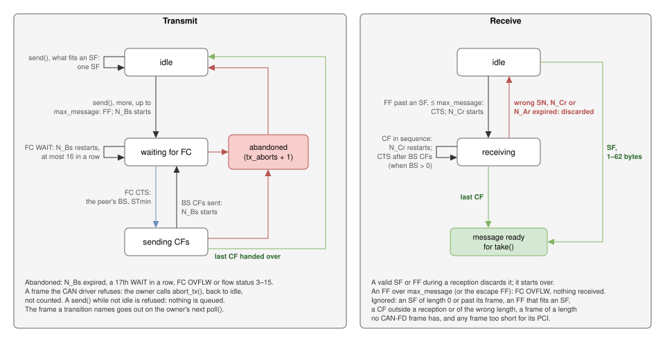
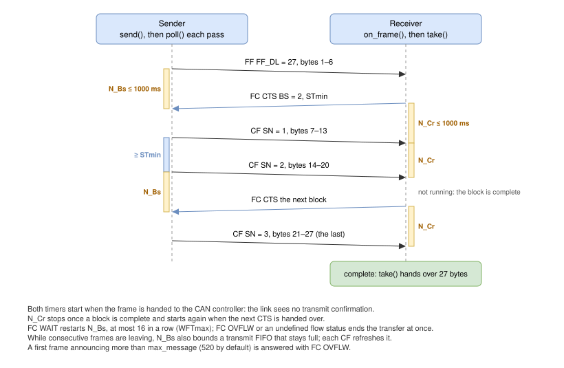

# CAN-TP — ISO-TP on CAN (ISO 15765-2)

The segmented transport UDS runs over on CAN: a message longer than one frame is sent as a first
frame and consecutive frames, paced by the receiver's flow control. This page says which parts of
ISO 15765-2 blobly implements, and how it behaves where the standard leaves the choice to the
implementation. The requirements are [`requirements/can-tp.toml`](../requirements/can-tp.toml)
(`REQ-CAN-TP-*`); the code is [`comm/isotp/isotp.v`](../comm/isotp/isotp.v) (the protocol, one
`Link` per connection) and [`comm/diag/step.v`](../comm/diag/step.v) (how a diagnostic server feeds
it frames and sends what it produces).

`Link` works on bare PDUs of up to 64 bytes, each carrying its length, and knows nothing about CAN
ids or the driver: its owner filters received frames by id and stamps the transmit id. It transmits
at the connection's frame length (TX_DL: 8, or up to 64 on a CAN-FD bus, §2) and receives frames of
any length without a setting. It is no-alloc and holds no message storage of
its own: the owner gives it a reassembly buffer and a transmit buffer (`bind_rx`, `bind_tx`), whose
sizes are the longest message it takes in and sends — on a node's diagnostic connection the node's
`[isotp] max_message` (§2), on the shell and trace streams their own fixed 520 bytes (§4). So a node
pays RAM only for the maximum it configures. A link nobody bound fails closed: it sends nothing and
answers every first frame with OVFLW. It is poll-based: `on_frame` takes a received PDU, `poll`
gives the next PDU to send, `tick` runs the timers, `send` starts a message and `take` hands over a
completed one.

## 1. What is supported

| Feature | Supported | Not supported |
|---|---|---|
| Frame types | single (SF), first (FF), consecutive (CF), flow control (FC). An FC received may be CTS, WAIT or OVFLW | — |
| Flow control we send | CTS, and OVFLW for a first frame too long to hold | WAIT: we never send one |
| Addressing | **normal addressing on 11-bit identifiers** (the default): one request id and one response id per connection. **Normal addressing on 29-bit identifiers** (`[isotp] ext = true`): the same, every id 29-bit (REQ-CAN-TP-040). **Normal fixed addressing** (`addressing = "normal_fixed"`): 29-bit ids derived from the node's address `sa` and the tester's `ta` — requests on `0x18DA<sa><ta>`, answers on `0x18DA<ta><sa>`, functional requests on `0x18DB<functional_ta><ta>` (REQ-CAN-TP-041, §3.8). The format is part of the id: a frame of the same number in the other format is never this connection's (REQ-CAN-TP-042) | **extended addressing** (the target address in byte 0) and **mixed addressing** (an address extension byte: 11-bit, or 29-bit `0x18CE…` / `0x18CD…`). Without `ext`, `[isotp]` refuses an id above `0x7FF` rather than promote it |
| Functional addressing | single-frame requests on the functional id — `functional_id`, or with normal fixed addressing `0x18DB<functional_ta><ta>` (§3.6) | multi-frame functional requests (ISO allows only single frames anyway) |
| Frame size (TX_DL) | **8** by default; 12, 16, 20, 24, 32, 48 or 64 per **`[isotp] tx_dl`** on a CAN-FD bus (§2): a single frame of up to TX_DL − 2 bytes behind the escape (`SF_DL` in byte 1), a first frame of TX_DL bytes, consecutive frames of TX_DL − 1 (§3.5). Frames of any length up to 64 are **received** without configuration. On a CAN-FD bus every frame goes out as a CAN-FD frame (FDF set; BRS set unless the image is built with `BLOB_FDCAN_NOBRS`), 8-byte ones included | a TX_DL above 8 on a classic bus (refused at generation) |
| Message length | 1 to the connection's maximum: the node's **`[isotp] max_message`**, 8–4095 bytes, **520** when not configured (§2) | a message above the maximum, and the escape first frame (`FF_DL` above 4095): both are refused with OVFLW (§3.4) |
| Padding | unused bytes `0x00`, to 8 bytes or, past 8, to the next CAN-FD length (12, 16, 20, 24, 32, 48, 64), never past TX_DL; flow control frames are 8 bytes | a configurable fill byte. We accept received frames shorter than 8, and a last consecutive frame shorter than its first frame (§3.5) |
| Timers | N_Bs, N_Cr and **N_Ar**, all 1000 ms; WFTmax 16 (§3.1). N_Bs bounds a send from its first frame on, consecutive frames that stop leaving included | **N_As**: a single or first frame that never reaches the controller is not bounded by a timer of the link's (an owner's own bound may end it, §4); the N_Br and N_Cs performance targets |
| Connections | one per node: the diagnostic server's (`[isotp]`). Its bootloader serves the same one | a second diagnostic connection (refused at generation, [diagnostics.md](diagnostics.md) §7) |

The same `Link` also carries a few non-diagnostic streams (§4); those use other ids but the same
protocol code.

## 2. Configuration: `[isotp]`

```toml
[isotp]
bus           = "can0"   # the CAN bus the connection runs on
rx_id         = 0x7E0    # physical requests arrive on this id (11-bit)
tx_id         = 0x7E8    # responses are sent on this id (11-bit)
functional_id = 0x7DF    # optional: functional requests, single frames only
bs            = 0        # block size we grant in our flow control (0 = the whole message)
stmin_ms      = 0        # STmin we ask the sender to keep, in milliseconds
max_message   = 520      # the longest message either way, in bytes
tx_dl         = 8        # the frame length we transmit with (above 8 only on a CAN-FD bus)
```

The same connection on 29-bit identifiers, by normal addressing or by normal fixed addressing
(§3.8):

```toml
[isotp]
bus           = "can0"
rx_id         = 0x18DA10F1   # 29-bit, because of ext
tx_id         = 0x18DAF110
ext           = true

# ... or the same ids derived from two addresses (no rx_id / tx_id / ext then):
# addressing    = "normal_fixed"
# sa            = 0x10       # this node: requests arrive on 0x18DA10F1, answers go on 0x18DAF110
# ta            = 0xF1       # the tester
# functional_ta = 0x33       # optional: functional requests on 0x18DB33F1
```

| Key | Range | Default | Notes |
|---|---|---|---|
| `addressing` | `"normal"`, `"normal_fixed"` | `"normal"` | how the ids are stated: given (`rx_id` / `tx_id`), or derived from `sa` / `ta`. Extended and mixed addressing are not supported |
| `rx_id`, `tx_id` | `0x000`–`0x7FF`; `0x00000000`–`0x1FFFFFFF` with `ext` | — | required with normal addressing, refused with `normal_fixed` |
| `functional_id` | as `rx_id` | absent = none | 0 also means none; refused with `normal_fixed` (`functional_ta`); not one of the connection's physical ids |
| `ext` | true / false | false | the three ids are 29-bit: received and sent with the extended (IDE) id (REQ-CAN-TP-040). Refused with `normal_fixed`, which is always 29-bit |
| `sa` | 0–255 | — | `normal_fixed`: this node's own address — N_TA of the requests it receives, N_SA of its answers. Required there, refused with normal addressing |
| `ta` | 0–255 | — | `normal_fixed`: the tester's address (e.g. `0xF1`) — N_SA of the requests, N_TA of the answers; not `sa`. Required there, refused with normal addressing |
| `functional_ta` | 0–255 | absent = none | `normal_fixed`: the functional target address (conventionally `0x33`, ISO 15765-4); functional requests arrive on `0x18DB<functional_ta><ta>` |
| `bs` | 0–255 | 0 | one byte on the wire |
| `stmin_ms` | 0–127 | 0 | milliseconds only: the microsecond codes `0xF1`–`0xF9` cannot be asked for |
| `max_message` | 8–4095 | 520 | the longest message either way. 4095 is the most a first frame states without the escape, which stays refused (REQ-CAN-TP-021). It sizes the connection's request and response buffers (generated storage, so the node pays for what it configures), the server's response capacity, the node's DoIP message limit and the maximum data size its entity status reports, a DoIP gateway's routed messages (a longer routed answer comes back responseTooLong, a routed bootloader's block offer is lowered to it), and its bootloader's buffers and TransferData block ([bootloader.md](bootloader.md)) — REQ-CAN-TP-023, REQ-CAN-TP-025, REQ-BOOT-020 |
| `tx_dl` | 8, 12, 16, 20, 24, 32, 48, 64 | 8 | the frame length the connection transmits with (§3.5). Above 8 only on a `[bus.*] fd = true` bus — the bus whose channel every generator opens CAN-FD (a host node's through cfg2v's `<bus>_fd`, a target's comm thread, a gateway's route buses and `BOOT_CAN_FD` through loom2v), all reading the key through one rule (`ecumodel.bus_fd`) — else refused at generation; any other value is refused by the schema check (ecucheck, the editor's JSON Schema) and at generation alike (REQ-CAN-TP-026). The node's bootloader (`BOOT_TX_DL`) and a DoIP gateway's route to the node (`[[doip.route]] tx_dl`, which sysgen writes; syscheck refuses an authored route whose `tx_dl` is not its node's) send with it too. Opt-in per node, so a tester that speaks classic frames only keeps working: a receiver takes any length without it |

A value outside its range is refused when the node is generated, never narrowed
(REQ-CAN-TP-020, REQ-CAN-TP-021). So is an id above `0x7FF` without `ext`, ids or `ext` given beside
`sa` / `ta`, a missing address, an address outside 0–255, and `sa` equal to `ta`
(REQ-CAN-TP-040, REQ-CAN-TP-041) — one reader states those rules for `[isotp]`, a system node's
`diag` and a gateway's `[[doip.route]]` alike (`tools/ecumodel` `diag_ids`). On a node of a
dissolved system ([multi-node.md](multi-node.md)) the node's `diag` in system.toml is the
allocation its server serves on: an `[isotp]` that states no ids at all (no `rx_id`, `tx_id`,
`functional_id`, `ext`, `addressing`, `sa`, `ta` or `functional_ta`) takes them from it — sysgen
writes the allocation's keys under the `[isotp]` header of the generated node; a `diag` on normal
addressing states no functional id, so a node answering one states its ids — and one that states
them must state the allocation's, format and functional id included (REQ-TOPO-014). Generation also refuses a `max_message` smaller than the longest
message the configuration says the server must exchange whole — a DID's 0x22 answer and 0x2E
request, the DTC list (0x19 02 / 0A), a DTC's snapshot (0x19 04) or extended data (0x19 06), and on a
`[boot]` node the bootloader's 66-byte 0x29 proof — naming that message (REQ-CAN-TP-022). A read of
several DIDs is not fixed by the configuration: one whose answer does not fit is answered
responseTooLong (0x14). N_Bs, N_Cr, N_Ar and WFTmax are not configurable: every owner of a `Link`
calls `init_defaults()`. The full key list is in [config-reference.md](config-reference.md).

## 3. Where the standard leaves the choice: what we do



*The state machines. The transmit side is drawn for TX_DL 8 and the default maximum message: with a
larger TX_DL a single frame carries up to TX_DL − 2 bytes (§3.5). The receive side holds for any
frame length.*

### 3.1 Timers



*A 27-byte transfer at TX_DL 8.*

| Timer | Value | Started | On expiry |
|---|---|---|---|
| **N_Bs** (sender waits for FC) | 1000 ms | when our first frame, or the last consecutive frame of a block, is handed to the CAN controller; restarted by each FC.WAIT | the transmission is abandoned and counted in `tx_aborts` |
| N_Bs as a **stall bound while sending CFs** | 1000 ms | on each CTS, refreshed by each CF handed over | the transmission is abandoned and counted. This covers a transmit FIFO that stays full (bus-off, nobody acknowledging), which ISO catches with N_As |
| **N_Cr** (receiver waits for CF) | 1000 ms | when our CTS is handed to the controller, at the first frame and at each block boundary; restarted by each CF in sequence | the partial message is discarded and no flow control is owed. Counted in `rx_aborts`, and the DoIP gateway ends its exchange on it (§4); the sender finds out from its own N_Bs or N_As |
| **N_Ar** (our flow control waits for the controller) | 1000 ms | when a CTS or an OVFLW first becomes owed (a first frame, or the end of a block); not restarted by a repeated first frame, nor by one replacing the reception while its CTS is still owed | the reception is abandoned and no flow control is owed. Counted in `rx_aborts` (REQ-CAN-TP-029) |
| **WFTmax** | 16 | counts FC.WAIT frames in a row within one block | the next WAIT after 16 abandons the transmission (counted) |

1000 ms is the timeout value the standard gives for N_Bs, N_Cr and N_Ar. The timers start when a frame
is handed to the controller, not on its transmit confirmation: the `Link` never sees a
confirmation. An FC arriving after N_Bs has expired does not revive the transmission
(REQ-CAN-TP-007), and neither does a CF arriving after N_Cr (REQ-CAN-TP-008). N_Cr is not armed
while our CTS is still waiting for room in the transmit FIFO, because the sender is then correctly
waiting for it. **N_Ar bounds that wait**: with a transmit FIFO that never drains (bus-off, nobody
acknowledging) the reception is abandoned 1000 ms after its flow control became owed, so the link
goes idle — S3 runs again and functional requests are served — for every owner, the diagnostic
server and the bootloader included; the DoIP gateway ends its exchange on it (§4). As for N_Bs and
N_Cr, "handed to the controller" is the end point: the `Link` sees no transmit confirmation.

### 3.2 The flow control we send

- **BS and STmin** are `bs` and `stmin_ms` from `[isotp]`, both 0 by default: the whole message
  in one block, frames as fast as the sender likes. With `bs` > 0 a new CTS goes out after every
  `bs` consecutive frames.
- **Never WAIT.** We always have a buffer ready, so we answer a first frame with CTS or OVFLW at
  once.
- **We don't police the sender.** We don't check that a sender keeps our STmin or stops at our
  block size. ISO 15765-2 leaves that to the sender (and the scope comment in `can-tp.toml` says
  so).

### 3.3 The flow control we receive, as a sender

- **BS**: we send at most that many consecutive frames, then wait for the next FC. 0 sends the
  rest without waiting (REQ-CAN-TP-004).
- **STmin**: at least that long between consecutive frames. `0x00`–`0x7F` are 0–127 ms and
  `0xF1`–`0xF9` are 100–900 µs (REQ-CAN-TP-005). A **reserved value** (`0x80`–`0xF0`,
  `0xFA`–`0xFF`) is read as `0x7F`, 127 ms, the slowest legal value (REQ-CAN-TP-006).
  The owner sends at most one frame per pass while it is pacing, so the real gap is STmin rounded
  up to its pass period (the comm thread's tick on a target, at least 1 ms). A microsecond STmin
  therefore comes out as one pass.
- **WAIT** restarts N_Bs, up to WFTmax in a row (§3.1).
- **OVFLW**, or a flow status the standard does not define (3–15), abandons the transmission at
  once and counts it, without waiting for N_Bs (REQ-CAN-TP-010).
- **An FC we are not waiting for** (no transmission in flight, or one in the middle of sending
  CFs) is ignored.

### 3.4 Receiving: what is accepted, ignored or abandoned

| Received | What we do |
|---|---|
| SF of at most 8 bytes with `SF_DL` 1–7 | delivered as a complete message (REQ-CAN-TP-003) — up to the maximum, which only a stream with no receive buffer has below 7 |
| SF longer than 8 bytes (CAN-FD) behind the escape: byte 0 `0x00`, `SF_DL` in byte 1, 1 up to the frame's length − 2 | delivered as a complete message, up to the maximum (REQ-CAN-TP-028). One longer than the maximum is ignored — a single frame has no flow control to refuse it with — and a reception in progress keeps running (REQ-CAN-TP-012) |
| SF of at most 8 bytes with `SF_DL` 0 (the escape) or above 7; an SF longer than 8 bytes whose byte 0 is not `0x00` (the classic form), or whose `SF_DL` is 0 or more than the frame holds | ignored. The escape is accepted with any `SF_DL` its frame holds, as blobly_net's ISO-TP and the Linux kernel's take it, not only one above 7 |
| FF of 8 bytes or a CAN-FD length, with `FF_DL` more than fits a single frame of that length, up to the maximum (`max_message`) | reception starts at RX_DL = the first frame's length, CTS sent (REQ-CAN-TP-028) |
| FF whose `FF_DL` fits a single frame of its length (1–7 in 8 bytes, up to RX_DL − 2 in a longer one) | ignored (a message that fits a single frame must be sent as one) |
| FF with `FF_DL` above the maximum, or the escape FF (`FF_DL` = 0, 32-bit length) | answered with FC **OVFLW** so the sender fails at once instead of waiting out its N_Bs (REQ-CAN-TP-015). Like any first frame, it ends a reception in progress. The escape FF is refused whatever length it states, since no maximum here reaches past 4095: ISO 15765-2:2016 and blobly_net *ignore* one stating 4095 or less (a length the 12-bit form states), and we answer it OVFLW too, so such a sender fails at once. blobly_net, as a receiver, takes an escape FF of 4096 to 65535 bytes and answers OVFLW only past its 65535-byte maximum |
| CF with the expected sequence number | appended. Numbers run 1…15, 0, 1… (REQ-CAN-TP-001) |
| CF with the wrong sequence number | the reception is abandoned and nothing of it is delivered. The next FF starts a new one (REQ-CAN-TP-011) |
| CF longer than RX_DL, or shorter than RX_DL while it does not carry all that is left (only the last CF may be short) | ignored, and the reception kept. ISO 15765-2:2016 (9.6.4) has every CF but the last carry RX_DL bytes; what a receiver does with one that does not is decided here as the Linux kernel's ISO-TP decides it (blobly_net aborts the reception instead). On the wire both end alike: the sender's next CF carries the following sequence number, a sequence error, and the reception is abandoned (REQ-CAN-TP-028) |
| CF with no reception in progress | ignored |
| A valid SF or FF (one the rows above accept) **while a reception is in progress** | the partial message is discarded and the new frame handled as a new reception (REQ-CAN-TP-012). A pending OVFLW is dropped too. An SF or FF that is ignored (rows above) leaves the reception running |
| A frame longer than 8 bytes of a length no CAN-FD frame has (9–11, 13–15, …) | ignored, whatever its PCI: a controller delivers only DLC lengths, so only a host's virtual bus can hand one over (REQ-CAN-TP-028). This rule is ours: blobly_net's ISO-TP and the Linux kernel's take such a single frame when it holds its `SF_DL` (both refuse a first frame of such a length) |
| A reserved PCI type (`0x4_`–`0xF_`) | ignored |
| A frame whose id or format is not the connection's: another id than `rx_id` / `functional_id`, or one of them in the other format (11-bit on a 29-bit connection, 29-bit on an 11-bit one) | not this connection's (REQ-CAN-TP-042) |

None of these outcomes is reported as an error code. ISO's `N_USData.indication` results
(`N_WRONG_SN`, `N_UNEXP_PDU`, `N_TIMEOUT_Cr`, …) have no counterpart: a reception that fails
simply delivers nothing. The tester sees it as a missing response. Only the timers' abandonments
(N_Cr, N_Ar) are counted (`rx_aborts`), for an owner that bounds an exchange.

### 3.5 Frame length (TX_DL, RX_DL)

**Transmitting**, the connection's TX_DL decides the frames (`[isotp] tx_dl`, §2; REQ-CAN-TP-027),
taken by `send` for the whole message:

| Message | At TX_DL 8 | At TX_DL above 8 (12 … 64) |
|---|---|---|
| 1–7 bytes | SF, `0x0N` + the message, padded to 8 | the same |
| 8 to TX_DL − 2 bytes | — | SF behind the escape: `00 SF_DL` + the message, padded to the next CAN-FD length |
| longer | FF of 8 (6 bytes of the message), CFs of 7 | FF of TX_DL (TX_DL − 2 bytes), CFs of TX_DL − 1 |
| the last CF | what is left, padded to 8 | what is left, padded to 8 or to the next CAN-FD length |

Every frame is padded with `0x00` to 8 bytes or, past 8, to the next length a CAN-FD DLC expresses
(12, 16, 20, 24, 32, 48, 64), never past TX_DL. Our flow control frames are 8 bytes at any TX_DL. A
message stays at most 4095 bytes (the 12-bit `FF_DL`; §1). The frame going out on a classic channel
must be 8 bytes, so generation refuses a TX_DL above 8 there (§2).

**Receiving**, any length is taken without configuration (REQ-CAN-TP-028), as blobly_net's ISO-TP
takes it: a reception's RX_DL is its first frame's length. A frame is read only as far as it arrived,
and a frame too short for its PCI, or of a length its reception does not allow, is dropped as if it
never arrived, so bytes that did not arrive are never read — the admission checks in `on_frame`
(`single_frame`, the first-frame verdict, the CF and FC length checks; REQ-CAN-TP-013):

| Frame | Accepted length |
|---|---|
| SF | at least `SF_DL` + 1 bytes (classic, at most 8); at least `SF_DL` + 2 behind the escape (a CAN-FD length above 8) |
| FF | 8, or a CAN-FD length: it sets RX_DL |
| CF | exactly RX_DL, unless it carries the last bytes of the message (then at least PCI + what is left, up to RX_DL) |
| FC | at least 3 bytes (PCI, BS, STmin) |

A frame longer than 8 bytes must be a CAN-FD length (12, 16, 20, 24, 32, 48, 64) whatever its PCI.
So a tester using TX_DL 8 on CAN FD (blobly_net's default) and one using TX_DL 64 are both served;
what the server answers with is its own TX_DL.

### 3.6 Functional requests

A request on the functional id (`functional_id`, or with normal fixed addressing
`0x18DB<functional_ta><ta>`; none when neither is configured) must be a single frame: PCI `0x0N`
with N from 1 to 7 in a frame of up to 8 bytes long enough to hold it, or the escape in a CAN-FD
frame longer than 8 bytes — decoded by the same `isotp.single_frame` as the physical id, so the two
ids cannot disagree about a frame (REQ-CAN-TP-028). Anything else on that id is discarded and does not disturb the physical
connection (REQ-CAN-TP-019). A valid one is served the moment it is read, in bus order, so a
functional 0x28 gates the very next frame. Its answer, if any, goes out on `tx_id` like a physical
answer. It is **dropped, not queued**, while the physical connection is busy in either direction or
a reset is pending: a functional TesterPresent is periodic and simply comes again. The bootloader
serves no functional requests.

### 3.7 Transmitting, and half duplex at the server

- **One message at a time per connection.** `send` refuses a message while another is in flight,
  or one of 0 bytes or longer than the connection's maximum. Nothing is queued; the owner asks
  `busy()` (REQ-CAN-TP-014, REQ-CAN-TP-016).
- **The message is copied into the transmit buffer**, so the owner may reuse its own at once —
  unless it sends from the transmit buffer itself, which the diagnostic server and the bootloader
  do: their response buffer IS the link's, written only while the link is idle, and their request
  buffer is the link's reassembly buffer, read before the pass goes on.
- **Up to 7 bytes go as a single frame** (up to TX_DL − 2 with a TX_DL above 8), longer messages
  as a first frame and consecutive frames (§3.5).
- **A frame the CAN driver refuses** (the channel would not take it) abandons the transmission
  rather than retrying it, because the receiver could never reassemble the rest
  (REQ-CAN-TP-018). The owner asked for that abort, so it is not counted in `tx_aborts`.
- **Abandoned transmissions are counted** (`tx_aborts`: N_Bs, WFTmax, OVFLW, an undefined flow
  status), so an owner can tell a message that was given up from one that was sent. Both leave
  the link free (REQ-CAN-TP-017). `progress` counts the frames that moved a transfer forward, for
  an owner that bounds a stalled exchange.
- **The server is half duplex.** A `Link` keeps receive and transmit state apart, but the
  diagnostic server takes a request only once the previous answer has left. A request that
  completes while an answer is still being sent is **dropped**: the tester has broken the
  half-duplex rule and will retry. A request that completes while a reset is pending is dropped
  as well ([`comm/diag/step.v`](../comm/diag/step.v) `take_request`).

### 3.8 Identifiers: their format, and normal fixed addressing

- **The format is part of the id** (REQ-CAN-TP-042). A connection is 11-bit or 29-bit as a whole:
  its request, response and functional ids share one format, and it takes a frame only when both
  the id and the format are its own. `0x7B0` as an 11-bit and as a 29-bit id are two frames; the
  other one is left to the owner's other receivers. The same comparison is made by the
  application's server ([`comm/diag`](../comm/diag/diag.v) `Connection.on_frame`), the bootloader
  (`diag.serve_step`, its `ext` from `BOOT_EXT`; `examples/boot_sim` on its 11-bit ids) and a DoIP gateway's router
  ([`comm/diagroute`](../comm/diagroute/diagroute.v) `Router.on_frame`, the route's `ext`). Every
  frame a 29-bit connection sends goes out with the extended id.
- **Normal fixed addressing at priority 6** (REQ-CAN-TP-043). ISO 15765-2 leaves the priority (the
  id's top three bits) open; we send 6, the conventional value (ISO 15765-4), as `0x18DA…` /
  `0x18DB…`. Ids are compared whole, with no mask, so only priority-6 frames are received: a request
  sent at priority 7 (`0x1CDA…`) is not served. The derivation is
  [`comm/isotp/addressing.v`](../comm/isotp/addressing.v) `fixed_id`, which the tools share.
- **No acceptance filtering in hardware.** The H7 FDCAN is set up to accept data frames of both
  widths into its receive FIFO with no filter elements (`driver/can/can_fdcan.c`: `GFC`, `SIDFC`),
  the ST HAL backend and SocketCAN likewise (SocketCAN carries a 29-bit id with `CAN_EFF_FLAG`), so
  a 29-bit diagnostic id needs no driver configuration: the (id, format) comparison above is the
  only filter. Hardware filter lists would gate every frame a node receives and are not used yet.
  Keeping the width in both directions, on a CAN-FD frame too, is the driver's REQ-CAN-DRV-010:
  the SocketCAN backend's encoding is tested on host (`driver/can/can_test.v`, through a socket
  pair), the FDCAN backends await a 29-bit node on silicon.
- **0 is no functional id**, in either format: a 29-bit functional id of 0 cannot be configured. With
  normal fixed addressing an absent `functional_ta` means none (a derived `0x18DB…` id is never 0).
- **The AUTOSAR CanIf backend** (`driver/can/can_canif.c`) maps (id, ext) pairs to PDUs: a 29-bit
  diagnostic connection needs rows with `ext = 1` there, or its frames are refused.

## 4. Who runs a `Link`

| Owner | Ids | Flow control it grants | Buffers | Notes |
|---|---|---|---|---|
| Diagnostic server ([`comm/diag`](../comm/diag/diag.v)): the host bridge, and the ThreadX comm thread on a target | `[isotp]` `rx_id` / `tx_id` / `functional_id`, or with normal fixed addressing the ids `sa` / `ta` / `functional_ta` derive (§3.8); 29-bit with `ext` or `normal_fixed` | `bs`, `stmin_ms` | a request and a response buffer of `max_message` bytes, generated beside the connection (the host bridge's state, `g_diag_req` / `g_diag_resp` on a target) and shared with the link | the connection this page describes, at the node's `tx_dl` |
| Bootloader ([`boot/target`](../boot/target/main.v), `diag.serve_step`) | the node's `[isotp]` ids and their format, from `gen/boot_gen.h` (`BOOT_RX_ID`, `BOOT_TX_ID`, `BOOT_EXT`) | the node's `bs`, `stmin_ms` | the same two, carved with the DoIP ones from one block `gen/boot_gen.h` sizes (`BOOT_MAX_MESSAGE`, `BOOT_BUF_LEN`, the `boot.bufs` layout) | same bus, ids and their format, frame format and frame length (the node's `tx_dl`, `BOOT_TX_DL`); no functional requests ([bootloader.md](bootloader.md)) |
| DoIP gateway router ([`comm/diagroute`](../comm/diagroute/diagroute.v)) | each routed node's request / response ids, in the node's format (`[[doip.route]] ext`, REQ-NET-021) | BS 8, STmin 0 | its link's two and one per queued answer, the gateway's own `max_message` each (`diagroute.storage_len`), kept apart because the doip thread fills the next request while the link still sends | the gateway acting as a **tester** on CAN. Each route sends at its node's `tx_dl` (`[[doip.route]] tx_dl`, lowered by sysgen; its flow control 8 bytes), and an answer is taken at whatever RX_DL the node sends. Besides the ISO timers: an answer reception ISO-TP abandons (N_Cr, or our flow control that could not leave within N_Ar) ends the exchange at once, counted in `timeouts`; an exchange whose frames stop moving for 5 s is ended (`stall_us`: a request whose single or first frame cannot leave); and an answer is awaited 6 s after the request left (`answer_wait_us`: P2*max plus 1 s). Past the gateway's maximum: a longer routed request never reaches it (the DoIP entity refuses it with the generic NACK 0x02 and discards it, the connection kept, REQ-CAN-TP-023); past the routed node's (`[[doip.route]] max_message`, the node's own), a request is refused at once with the diagnostic NACK 0x04 rather than forwarded to be refused with FC.OVFLW; a longer answer is refused on the bus with FC.OVFLW and answered to the tester in the node's name as `7F <service> 14` — when its first frame answers the request in flight, a late one being dropped like any late answer; and a RequestDownload answer's block length is lowered to the gateway's maximum, so a node with a larger one is reprogrammed through it in blocks it carries (REQ-CAN-TP-025, [net.md](net.md)) |
| Shell response ([`comm/shell`](../comm/shell/shell.v)) and trace dump ([`comm/trace`](../comm/trace/module.v)) | a stream id plus a separate flow-control id (`out` / `fc`, `record` / `dump_fc`) | — (they send messages, never receive one) | a transmit buffer of 520 bytes, their own whatever the node's `max_message` (`shell.max_rsp`, `trace.dump_block`: an 8-byte header and 64 records), and none to receive into | one ISO-TP message per response or dump block, at TX_DL 8 whatever the node's `tx_dl`; the request is a plain frame, not ISO-TP ([onboard_trace.md](onboard_trace.md)). Only a **flow control** (PCI type 3, at least PCI, BS and STmin) received on the flow-control id reaches the link — the one rule both call, `isotp` `on_flow_control`: any other frame there, a first frame above all, is dropped, so it never starts a reception or puts a flow control into the stream (REQ-CAN-TP-024) |

## 5. Verification

Every requirement in `requirements/can-tp.toml` is verified by a unit test:
[`comm/isotp/isotp_test.v`](../comm/isotp/isotp_test.v) for the protocol,
[`comm/diag/diag_test.v`](../comm/diag/diag_test.v) and
[`comm/diag/step_test.v`](../comm/diag/step_test.v) for the frame intake and the driver-refusal
abort and the maximum message's server capacity,
[`comm/shell/shell_test.v`](../comm/shell/shell_test.v) and
[`comm/trace/module_test.v`](../comm/trace/module_test.v) for the flow-control-only streams, the DoIP
tests ([`comm/doip`](../comm/doip/doip_test.v), [`comm/diagroute`](../comm/diagroute/diagroute_test.v),
[`driver/doipnet`](../driver/doipnet/doipnet_test.v)) for the entity and the gateway following the
maximum, and [`tools/loom2v/diag_target_test.v`](../tools/loom2v/diag_target_test.v) (with
`fault_target_test.v` and `doip_target_test.v`) for the configuration ranges, the refusal of a
maximum too short for what the node exchanges and the generated buffers. The frame length's other
owners: `step_test.v` runs the bootloader's link, configured as its image configures it
(`boot.LinkCfg`, every field required), through the bootloader's serve step at TX_DL 8 and 64;
[`tools/sysgen`](../tools/sysgen/node_gate_test.v) reads zone_a's `tx_dl = 64` from its ecu.toml and
lowers it onto sysnode's route, and syscheck refuses an authored route whose `tx_dl` is not its
node's; [`tools/cfgschema`](../tools/cfgschema/cfgschema_test.v) holds the schema's set of lengths
to `isotp.valid_dl`, so ecucheck refuses what generation refuses. The identifier formats:
[`comm/isotp/addressing_test.v`](../comm/isotp/addressing_test.v) pins normal fixed addressing's ids
(the same golden vectors as blobly_net's `blobly/sysview`), `diag_test.v`, `step_test.v` and
`diagroute_test.v` run 29-bit connections, routes and bootloader steps next to their numbers in the
other format, [`tools/ecumodel/addressing_test.v`](../tools/ecumodel/addressing_test.v) the reader's
refusals, `diag_target_test.v` / `doip_target_test.v` the generated configuration and the
format-aware collision checks, [`tools/sysmodel/diag_format_test.v`](../tools/sysmodel/diag_format_test.v)
the system checks (a diag-only node's ids, routes and the NM range by format, and an `[isotp]` that
states no ids taking its node's `diag`), [`tools/sysgen/gen_test.v`](../tools/sysgen/gen_test.v)
the lowering of a `diag` into such an `[isotp]`, and
[`tools/sysgen/fb_move_test.v`](../tools/sysgen/fb_move_test.v) generates system_full with zone_a on
normal fixed addressing, stated once in its `diag` and lowered into its `[isotp]` and its gateway's
route, and type-checks zone_a's and its gateway's images.
`isotp_test.v` runs the
length cases at the floor, the default and the limit (8, 520, 4095), every TX_DL against a receiver
with no setting, and pins the CAN-FD frames with blobly_net's own byte vectors
(`blobly/isotp/fd_test.v` — its fill bytes `0xAA` / `0xCC` read `0x00` here, and a frame a CAN-FD
bus carries at its padded length where it hands the bus a shorter one). The status table is [traceability.md](traceability.md). On the bus, blobly_net's
ISO-TP and UDS client exchanges single- and multi-frame messages with every example's server, on
classic CAN and on zone_a's CAN-FD bus; system_full's zone_a is configured at 4095 and at TX_DL 64
(its bootloader too, and sysnode's route to it), and
[`examples/system_full/test/isotp_len.lua`](../examples/system_full/test/isotp_len.lua) runs messages
over 520 both ways against it, and against domain at the default, and exchanges 64-byte frames with
zone_a directly and through sysnode's route;
[`boot_handoff.lua`](../examples/system_full/test/boot_handoff.lua) checks each CAN bootloader's
0x29 challenge on the wire at its node's TX_DL (one 48-byte frame behind the escape on zone_a, a
first frame of 8 on the classic bus). Nothing runs 29-bit ISO-TP on a
wire yet: every example and bench suite uses 11-bit ids, so 29-bit and normal fixed addressing are
verified by the unit and generation tests above, not on the bus.
