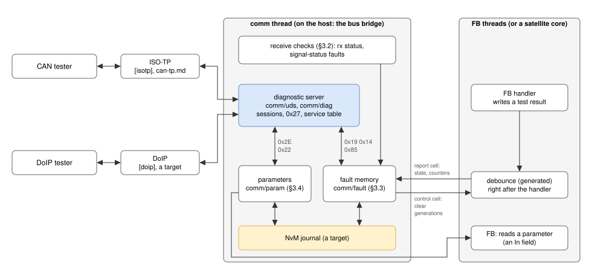
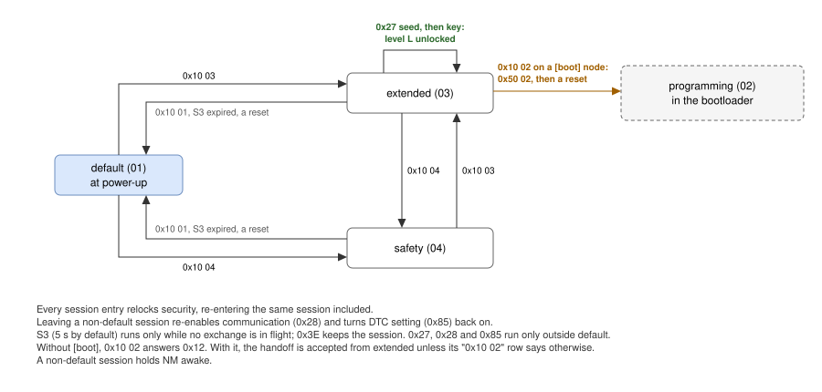

# Diagnostics — UDS (ISO 14229-1), fault memory, parameters

A production ECU is serviced through its diagnostic interface. The workshop reads what went wrong
(DTCs, with a snapshot of the conditions), clears it after the repair, and codes the vehicle
variant. This page says which parts of ISO 14229-1 blobly implements, how it behaves where the
standard leaves the choice to the implementation, and what it does not do.

- Requirements: [`requirements/diag.toml`](../requirements/diag.toml) (`REQ-DIAG-*`), one behaviour
  each. Its scope note lists the same non-goals as §1 and §5.
- Code: [`comm/uds`](../comm/uds/uds.v) (the server; [`routine.v`](../comm/uds/routine.v) and
  [`pending.v`](../comm/uds/pending.v) for routines and responsePending), [`comm/diag`](../comm/diag/diag.v) (the
  server on its connection), [`comm/fault`](../comm/fault/fault.v) (debounce and the fault memory),
  [`comm/param`](../comm/param/param.v) (parameters). Generated by `tools/loom2v`
  (`gen_diag.v`, `gen_param.v`, `gen_xfault.v`, `gen_routine.v`).
- Transports: CAN through ISO-TP ([can-tp.md](can-tp.md)), and DoIP on a ThreadX target
  ([net.md](net.md)). Every configuration key: [config-reference.md](config-reference.md#ecu-uds).



## 1. What is supported

A node has **one diagnostic server**, whichever transport a request arrives on. It serves the
services of its **service table** (`[uds] services`, §3.1), each in the sessions and behind the
security level its row names (unlocked by 0x27, or by 0x29 on an authenticating node), so "served" below means "can be served".

### Per service

| SID | Served | Not served |
|---|---|---|
| 0x10 | **DiagnosticSessionControl**<br>01 default, 03 extended, 04 safety. 02 programming only as the bootloader handoff of a `[boot]` node, else 0x12. The answer carries P2server_max 50 ms and P2\*server_max 5 s | other (OEM) sessions |
| 0x11 | **ECUReset**<br>01 hardReset, 03 softReset: answered, then performed, never performed unanswered | 02 keyOffOnReset, 04 / 05 rapid power shutdown |
| 0x14 | **ClearDiagnosticInformation**<br>all DTCs (0xFFFFFF) or one DTC. On a target, stored before the answer (0x72 otherwise) | DTC groups other than "all"; the memorySelection byte |
| 0x19 | **ReadDTCInformation**<br>01, 02, 03, 04, 06, 0A | every other sub-function (05, 07–09, 0B–19, 42, 55, …) |
| 0x22 | **ReadDataByIdentifier**<br>several DIDs per request; up to 16 DIDs of up to 32 bytes: constants, live signals, parameters and their status, `tx_saturations`; 0xF186 (the active session) and, with `[boot]`, 0xF195 (the running image's version), served by the server itself. A live DID of a controlled signal reads the value published (the FB's held to its range as the encoder sends it; the initial value before the FB's first publish) | ISO identification DIDs not declared as constants |
| 0x27 | **SecurityAccess**<br>levels 1–8, a 4-byte seed, attempt limit and lockout delay, the failed-key count kept across a reset — on a node with `access = "seed_key"` (the default) | a power-up delay; a securityAccessDataRecord is accepted and ignored; on a node with `access = "authentication"` (answered 0x11) |
| 0x29 | **Authentication**<br>on a node with `access = "authentication"`: 00 deAuthenticate, 05 requestChallengeForAuthentication, 06 verifyProofOfOwnershipUnidirectional — ISO's challenge-response with Ed25519, unlocking the same levels 0x27 would (§3.1). The bootloader has its own profile ([bootloader.md](bootloader.md)) | 01 verifyCertificateUnidirectional, 02 verifyCertificateBidirectional, 03 proofOfOwnership, 04 transmitCertificate (the certificate exchange, APCE); 07 verifyProofOfOwnershipBidirectional (bidirectional ACR); 08 authenticationConfiguration — all answered 0x12; on a `seed_key` node, 0x29 itself (answered 0x11) |
| 0x28 | **CommunicationControl**<br>00–03 on normal messages, this network (or all networks on a node with one) | network-management message types; 04 / 05 (enhanced address information) |
| 0x2E | **WriteDataByIdentifier**<br>writable RAM DIDs (a record of exactly the DID's size) and parameters (stored before the answer) | — |
| 0x2F | **InputOutputControlByIdentifier**<br>00 return control, 01 reset to default, 02 freeze current state, 03 short-term adjustment, on a live `[[did]]` declared with a `control` (up to 4), applied where the node publishes the signal, never inside an FB (§3.1) | a controlEnableMask (signals of several fields); a signal whose DBC names values outside its range, whose scaling leaves a whole value between raw steps, or whose raw mapping f64 cannot hold exactly; a multiplexed signal or a multiplexor; functional requests (ignored) |
| 0x31 | **RoutineControl**<br>01 start, 02 stop, 03 results, per `[[routine]]`, each run by an FB and answered responsePending (0x78) while it runs (§3.1 "Routines"); in the bootloader, its erase and check routines ([bootloader.md](bootloader.md)) | functional requests; identifiers outside 0x0200–0xDFFF and 0xF000–0xFEFF |
| 0x3E | **TesterPresent**<br>00 | — |
| 0x85 | **ControlDTCSetting**<br>01 on, 02 off; an option record is accepted and ignored | — |
| 0x34, 0x36,<br>0x37 | **RequestDownload, TransferData, RequestTransferExit**<br>by the **bootloader** only: the download ([bootloader.md](bootloader.md)) | in an application (answered 0x11) |
| others | — | 0x23 / 0x3D memory access, 0x24, 0x2A, 0x2C, 0x35, 0x38, 0x83, 0x84, 0x86, 0x87, OBD services: answered serviceNotSupported (0x11) |

### Across services

| Topic | What we do |
|---|---|
| Negative responses | 0x11 0x12 0x13 0x14 0x22 0x24 0x31 0x33 0x35 0x36 0x37 0x58 0x59 0x72 0x78 0x7E 0x7F, in ISO 14229-1's evaluation order (§3.1) |
| Functional requests | single frames only; the ISO-suppressed negative responses (0x11, 0x12, 0x31, 0x7E, 0x7F) are withheld; a functional 0x27, 0x29, 0x2F or 0x31 is ignored outright (no seed, challenge, control or routine, no answer) |
| responsePending (0x78) | sent by an application **only while an answer is owed** — a routine's (§3.1 "Routines") or a 0x29 proof's while it is verified (§3.1 "Authentication"): at once, then every 4 s (P2\*server_max − 1 s), then the final answer (§3.1). A write never needs it: every write that must be stored is one synchronous journal append that never erases, well inside P2 |
| busyRepeatRequest (0x21) | **not sent**. A request that arrives while an answer is in flight, or while an answer is owed, is dropped; the tester retries (the bootloader answers 0x21 during its own routines) |
| P2 on silicon | P2server_max is announced as 50 ms; measuring it on the bench (REQ-DIAG-064) is still to do |

### Where it runs

| Feature | Host bridge | ThreadX target |
|---|---|---|
| The server: sessions, gating, constant DIDs, functional requests | yes | yes |
| Live DIDs (an integer or bool value, never a float) | any such signal | only a signal this node transmits on CAN from an owner FB, or a value an FB on a generated satellite core writes; at most 32 bits |
| 0x27 key | blobly_net's reference key | the board's `diag_sa_key_ok` (no default is linked), or the reference key by name for a bench (`security_key = "reference"`); seed from the board's TRNG |
| 0x29 keys | `auth_keys`; the challenge from the reference generator | `auth_keys`; the challenge from the board's TRNG; a 16 KB comm stack for the verifier |
| 0x11 | returns the diagnostic state to power-on | resets the MCU once the answer is on the wire |
| 0x27 failed-key (0x29 failed-proof) counts across a reset / power cycle | in RAM across its resets (it has no power cycle) | in the NvM journal, across every reset and a power cycle (`[nvm]` required) |
| 0x10 02 handoff to the bootloader | — | with `[boot]` |
| 0x2F | a signal the `[isotp]` bus's bridge sends; every request accepted (no application hook) | a signal the comm thread sends (an owner FB's, or a satellite's single-field signal), at most 32 bits; the board's weak `diag_io_ok` may refuse (0x22) |
| 0x28 | gates the application's frames | gates the application's frames |
| Fault memory (0x19 / 0x14 / 0x85) | RAM only | stored in the NvM journal; faults may be owned by an FB on a satellite core |
| Operation cycle | a declared bool signal, or `"power"` | NM (wake to bus sleep), or `"power"` |
| Parameters (0x2E coding) | — | yes, satellite readers included |
| Routines (0x31) | run by an FB in any single-thread partition | run by an FB in a single-thread partition on the owner image (not on a satellite core yet, REQ-PLACE-013); not on bare metal |
| DoIP | — | with `[doip]` |

The server is bench-verified on all three `system_full` CAN nodes: domain (H755), the gateway
sysnode (H735) and zone_a (H723, on the CAN-FD edge bus). §6 lists the guarantees and the tests and
bench suites behind them.

## 2. Principles

1. **Faults and parameters reach an FB through ports, not an API.** An FB writes a test result to
   an Out field and reads a parameter from an In field. No `SetEventStatus`, no return codes, and
   nothing comes back: an FB never reads its fault's status (§3.3).
2. **Diagnostics is a platform service, not an FB.** The server and the fault memory run in ONE
   comm thread: the one serving the node's `[isotp]` bus (on the host, that bus's bridge). It is the
   single writer of the fault memory and owns the journal. Every other detector reaches it through
   IOC cells it alone reads, so no lock is needed.
3. **Everything is declared in `ecu.toml`, checked at generation and by syscheck.**
   - Physical request and response ids are unique per bus; a functional id is shared by every
     server on its bus, and never equal to a physical id there.
   - DIDs and DTC numbers are unique per node: every ECU may expose 0xF190, and one DTC value may
     mean different things on two ECUs.
   - One diagnostic server per node keeps the fault memory, its clears and 0x85 with one owner.
4. **No heap**: fixed tables sized at generation, like every runtime layer.
5. **Sim first, then silicon, with a tester to prove it.** blobly_net is the oracle, not shared
   code.
6. **Our own words**: "diagnostic server", "fault", "fault memory", "test result", "operation
   cycle", never DCM / DEM names.

## 3. Design: where the standard leaves the choice

### 3.1 The diagnostic server

#### Configuration

The configuration follows the standards' layers. **`[uds]` is the server** (ISO 14229, one per
node); **its transports refer to it**: `[isotp]` on CAN ([can-tp.md](can-tp.md)), `[doip]` on
Ethernet ([net.md](net.md)). `[isotp]` states its CAN ids by normal addressing — `rx_id` /
`tx_id` / `functional_id`, 11-bit, or 29-bit with `ext = true` — or by normal fixed addressing
(`addressing = "normal_fixed"`, the node's address `sa` and the tester's `ta`, from which the 29-bit
ids `0x18DA<sa><ta>` / `0x18DA<ta><sa>` derive, and functional requests on
`0x18DB<functional_ta><ta>`); the node's bootloader serves on the same ids in the same format
([can-tp.md](can-tp.md) §2, §3.8). In a dissolved system an `[isotp]` may state no ids and take its
node's `diag` from system.toml, which sysgen writes into it ([multi-node.md](multi-node.md)).

```toml
[uds]                           # ISO 14229: the node's ONE diagnostic server
s3_ms             = 5000        # session timeout (default 5000)
security_attempts = 3           # 0x27 wrong keys before the lockout (default 3)
security_delay_ms = 10000       # 0x27 lockout delay (default 10000)
security_key      = "reference" # a target only: blobly_net's bench key; absent = the OEM's diag_sa_key_ok
# access          = "authentication"          # unlock with 0x29 instead of 0x27 (default "seed_key")
# auth_keys       = { "1" = "reference" }     # with it: per level, the tester's Ed25519 public key

[uds.services]                  # optional; absent = the default table
"0x10" = {}
"0x11" = { sessions = ["extended"] }
"0x22" = {}
"0x27" = {}
"0x2E" = { sessions = ["extended"], security = 1 }
"0x3E" = {}

[[did]]
id    = 0xF190
ascii = "BLOBLY0000000001"
read  = { session = ["default", "extended"] }
[[did]]
id     = 0xF1A0
signal = "VehicleSpeed"
[[did]]
id    = 0x0110
param = "SteerLimit"            # §3.4
write = { session = ["extended"], security = 1 }
```

#### The service table

Which services the server answers, in which sessions and behind which security level. A row is keyed
by its SID in hex and may carry `sessions` (`default` / `extended` / `safety`; absent = the
service's default sessions) and `security` (a level 1..8, unlocked by 0x27 or 0x29; absent = none). The same table configures
the server on the host bridge and the ThreadX comm thread, and a DoIP request reaches the same
server.

Dispatch checks it after "is the service built in", in ISO 14229-1's order:

1. **0x11** serviceNotSupported: the table leaves the service out (withheld for a functional
   request);
2. **0x7F** serviceNotSupportedInActiveSession: outside its sessions;
3. **0x33** securityAccessDenied: below its level;

then the length check and any per-DID gate.

**Absent, the default table**: every service the build performs; 0x27, 0x28, 0x2F and 0x85 in the
extended session only (and programming, in the bootloader), so not in safety; everything else in
every session; no service-level security.

**What a build performs**: 0x10, 0x22, 0x2E and 0x3E always; 0x11 and 0x28 on both owners;
0x14, 0x19 and 0x85 with a `[[fault]]` memory; 0x31 with a `[[routine]]` (on the host bridge or a
ThreadX target, never bare metal); 0x2F when a `[[did]]` declares a `control`; 0x27 when a `[[did]]`
gate or control, a `[[routine]]` or a row names a level. A table never claims a service that does
nothing: a row for one the build does not perform is refused — and a table must list 0x31 when the
node has a `[[routine]]` (below).

**Refused at generation** (each error names `[uds]`):

| Refused | Why |
|---|---|
| a service the build does not perform, or `comm/uds` does not implement (a `"0x2F"` row with no `control`) | a row must not promise nothing |
| the programming session in any row | it belongs to the bootloader |
| 0x27, 0x28, 0x2F or 0x85 in the default session | ISO 14229-1 runs them only in a non-default one |
| a 0x10 row without the default session; a row reachable only outside default with 0x10 left out | a tester could never reach it |
| a level on 0x10, 0x27 or 0x3E | they are how a tester reaches, unlocks and keeps a session |
| a level on a row not allowed in extended; a 0x27 row without extended | an application server unlocks only in extended |
| a table without 0x27 while a level is gated, without 0x22 while a DID exists, without 0x2E while one is writable, without 0x2F while one has a `control` | the gate would be unreachable |
| a DID gate or control sharing no session with its service's row (the default table's 0x2F row included), or naming another level than the row | one unlock cannot satisfy both |
| a DID gate or control whose level — its own, else its row's — leaves out extended among the sessions both allow | an application server unlocks only in extended, and entering another session relocks |
| more than 16 rows (`uds.max_services`) | fixed table |

**The handoff's row**, `"0x10 02" = { sessions = [...], security = N }`, only with `[boot]`: the one
sub-function row. 0x10 consults it once the sub-function is known: **0x7E** outside its sessions,
**0x33** below its level, then the length (0x13) and the application's conditions (0x22). Absent,
the handoff is accepted from the extended session with no level, so a stray request on a quiet bus
cannot restart a running ECU into its bootloader.

The old `[[isotp]]` array, and a server key (`s3_ms`, `security_*`) or `name` in `[isotp]`, are
refused with the move they need.

#### Sessions and S3

- **Start in default.** S3 (`s3_ms`, 5 s by default) returns a non-default session to default.
  S3 does not run while an exchange is in flight on either transport (ISO 14229-2 starts it once
  the exchange is over).
- **Every session entry relocks security**: an explicit 0x10, re-entering the same session, S3 or
  a reset. An expired unlocked session cannot be re-entered without a new seed and key.
- **Returning to the default session** (explicitly, by S3 or by a reset) re-enables communication
  0x28 disabled and turns DTC setting back on (0x85). A switch between two non-default sessions
  keeps both as they are.
- **An application never enters programming.** Without `[boot]` 0x10 02 is refused (0x12). With
  it, 0x10 02 is the handoff (below).
- **A non-default session, or an exchange in flight on CAN, holds NM awake** on a ThreadX node
  with NM: diagnostic frames are not NM messages and would not refresh it.



#### Security access (0x27)

| Choice | What we do |
|---|---|
| Levels | 1–8; level L uses sub-functions 2L−1 (seed) and 2L (key). The levels in use are the ones the DID gates and service rows name |
| Seed | 4 bytes, from the board's TRNG on a target. All zeros when the level is already unlocked |
| Key | one key per seed, checked through an injected seam (`SecurityOps`), so `comm/uds` holds no algorithm. A target links the OEM's `diag_sa_key_ok`; the bench and the host use blobly_net's public reference key (seed XOR 0xFF), so both sides unlock with one algorithm |
| A key before its seed | 0x24 requestSequenceError |
| Wrong keys | 0x35 invalidKey; the `security_attempts`-th wrong key (the 3rd by default) is answered 0x36 and starts that level's lockout, during which its seed request is answered 0x37 for `security_delay_ms` (10 s) — and so is a key answering a seed drawn over the other transport before the lockout began (the key not judged, the seed spent), so no transport adds a guess to a lockout. The count and the delay are per level: a lockout of one level never delays another level's seed |
| Across a reset | each level's wrong keys since its last correct key are kept, so a reset buys nothing: a start with a wrong key counted since that level's last correct key costs the full lockout delay from start-up — after a lockout that has ended too, and a reset during one restarts it. A count below the limit carries over; after the delay of a count at the limit the level has its attempts again, as after any lockout. So no reset or power cycle grants more than `security_attempts` keys per lockout delay while the journal takes the state (a full journal: below). A start after a correct key never waits |
| Across a power cycle | kept on a target, in the node's NvM journal: one 10-byte record at a fixed block (0x044E) holding, per level, the wrong keys since its last correct key, counted up to `security_attempts` and no further (a count at the limit is the lockout: no clock is stored). Restored before the first request is served. **Written only when it changes**: a wrong key below the limit raises its level's count, and a correct key clears a non-zero count — one write each, in the pass that answered the key, before the CAN answer is pumped. Nothing else changes the record, so nothing else writes: not a correct key with nothing counted, a wrong key at the limit, the lockout beyond the key that reached the limit, its end, a start-up or an ECUReset — no budget, and no special flush before an ECUReset or the programming handoff (the journal is current after every write). So at most `security_attempts` writes per level between correct keys, plus one by a correct key that follows a wrong one: a tester without the key writes at most `security_attempts` records per level, ever, until an authorised unlock, and can neither fill the journal for the fault memory and the codings nor wear it past the wear check. The price: a count at the limit stays stored until that level's correct key, so every start-up meanwhile runs that level's full delay (0x37 to its seed; another level's seed is not delayed). A node that performs 0x27 (or 0x29, whose failed proofs are this count) must declare `[nvm]`; generation refuses it otherwise. The host bridge keeps the count in RAM |
| A record it cannot read | another layout (format byte, level count, length — the earlier 11-byte layout included), or an unreadable journal, restores nothing: no delay, as a clean start. A count of a level the firmware no longer serves is not restored and arms nothing (its seed is refused 0x12, and its correct key, so nothing could clear it); the first pass writes the record without it. A count above the limit (an update that lowered `security_attempts`) reads as saturated |
| A refused write | changes no answer: the key is judged and the count in RAM counts. Retried after `[nvm] min_write_ms`, and at once by every flush, until the journal holds the record; never erased for — the write is the pass's, before the CAN answer, so it is one append (REQ-DIAG-062). A journal another writer filled holds the changes in RAM until its next erase point: the flush after an ECUReset's answer erases and takes them across the reset (REQ-DIAG-033), and so does a sleep edge with NM. A power cut, or a reset the server did not perform, before then restores the record last accepted — the counts since the journal filled are lost, as they are for the fault memory and the codings; a node without NM then erases at boot, an NM node at its next sleep edge. A correct key's clear the journal refuses leaves a higher count stored: a power cut then costs a delay, never a key |
| Two transports | an unlock belongs to the transport that earned it: a DoIP tester never inherits a CAN tester's unlock, nor the reverse; a seed asked over one never replaces the other's challenge |

#### Authentication (0x29)

A node unlocks its levels **one way**: `[uds] access = "seed_key"` (the default, 0x27 above) or
`access = "authentication"`, ISO 14229-1's authentication with challenge-response (ACR),
unidirectional, with Ed25519. With authentication 0x27 is answered serviceNotSupported (0x11), and a
service table row naming it is refused at generation (and a 0x29 row on a seed-key node). Both ways
grant the SAME levels: every gate — DID read and write gates, service rows, the `"0x10 02"` handoff
row — names a level 1..8, and a verified proof unlocks that level exactly as a correct 0x27 key does.

```toml
[uds]
access            = "authentication"
auth_keys         = { "1" = "reference", "2" = "3b6a27bc...<64 hex>" }
security_attempts = 3           # failed proofs before the lockout, as for 0x27 keys
security_delay_ms = 10000
```

`auth_keys` maps each level a gate names to the tester's Ed25519 **public** key — 64 hex characters,
or `"reference"`: blobly_net's dev tester key, the public half of `examples/keys/tester.seed`, which
the bootloader's `session_key` already trusts. Generation refuses a gated level with no key, a key
for a level nothing gates, a key that is not 64 hex, is all zeros or is not a curve point, a key
equal to `[boot] image_key`, `auth_keys` on a seed-key node and `security_key` on an authenticating
one. On a `[doip]` node a `"reference"` key needs `allow_bench_key = true`, as the 0x27 reference
key does; 0x29 is open over the network like 0x27 (it is how a tester authenticates). On a target
the node needs `[nvm]` (the failed-proof count, below), its `[isotp] max_message` must hold the
88-byte proof request, and its comm thread gets a 16 KB stack (the verify's field arithmetic runs on
it; its state, about 2.8 KB, is held beside the keys in static storage)
([examples/uds_auth](../examples/uds_auth) is the host example; `scripts/auth_target_check.sh` cross-builds a ThreadX one).

| Request | Bytes | Positive answer |
|---|---|---|
| 05 requestChallengeForAuthentication | `29 05 cc alg[16]` (19) — `cc` (communicationConfiguration, offset 2) the level; `alg` (algorithmIndicator, offset 3) the Ed25519 OID | `69 05 00 alg[16] 00 20 challenge[32] 00 00` (55): requestAccepted, the algorithm echoed, the challenge at offset 21, no additional parameter |
| 06 verifyProofOfOwnershipUnidirectional | `29 06 alg[16] 00 40 proof[64] 00 00 00 00` (88): `alg` at 2, the proof length at 18, the proof at 20, the client challenge length at 84 and the additional parameter length at 86 (both 0) first `7F 29 78` (responsePending), then `69 06 12 alg[16] 00 00` (21): ownershipVerified, the algorithmIndicator (offset 3), lengthOfSessionKeyInfo 0 — no session key (ISO 14229-1:2020's layout) |
| 00 deAuthenticate | `29 00` (2) | `69 00 10` (3): deAuthenticationSuccessful |

| Choice ISO leaves open | What we do |
|---|---|
| Which level a proof unlocks | the level is the **communicationConfiguration** byte of 05 (1..8) — the one manufacturer-specific byte, unused since no secure communication is configured — and is bound to the challenge, so 06 carries none. A generic tool sending 0x00 there is refused 0x31 |
| Algorithm | Ed25519; `algorithmIndicator` is its object identifier 1.3.101.112 in DER (`06 03 2B 65 70`), left-aligned and zero-padded to 16 bytes. Another is refused 0x31 |
| What the proof signs | exactly the 32-byte challenge — the bootloader's message (REQ-BOOT-016), so a tester signs once for both. Safe without domain separation because the level is bound on the server and every challenge is fresh |
| The challenge | 32 bytes from the source 0x27's seeds come from (`SecurityOps.seed`: the board's TRNG on a target, the reference generator on the host). A source that fails or draws all zeros: 0x59 challengeCalculationFailed. One proof per challenge, a failed one included; voided by a new 05, every session entry (the same session too), S3, a reset, 00 and the end of the transport connection that asked; per transport, like a seed |
| A failed proof | 0x58 ownershipVerificationFailed, counted as a wrong key of its level: the same count, `security_attempts` (the last one 0x36, starting the lockout), `security_delay_ms` (05 answered 0x37 meanwhile, and after a start-up or reset with a count; so is a 06 answering a challenge drawn over the other transport before the lockout began — not verified, not counted, the challenge void) and the same persisted record — a power cycle buys no extra proofs |
| Sessions | ISO 14229-1 allows 0x29 in the default session; this server does not (0x7F), like 0x27 — a **project choice** (REQ-DIAG-121): every session entry relocks, so a level unlocked in the default session would be gone by the extended session every gate needs. A service table row naming the default session for 0x29 is refused at generation, saying so |
| Other sub-functions | 01–04 (APCE), 07 (bidirectional ACR) and 08 answered 0x12 |
| Suppression | honoured on 00; 05 always answers (the challenge is the answer), and so does 06: its responsePending lifts the suppression (ISO 14229-1) |
| Functional | ignored outright, like 0x27 |
| 05 for an unlocked level | a fresh challenge |
| deAuthenticate | relocks the requesting transport's unlock — its controls returned and its routines asked to stop, as any relock (REQ-DIAG-105, REQ-DIAG-085) — and voids its challenge; the other transport's unlock stands (REQ-NET-012) |
| Verify time | an Ed25519 verify is about 10,300 field multiplications — estimated (not measured) at some 75–100 ms on a 400 MHz Cortex-M7 at `-Os`, from the instruction count of the TweetNaCl multiplication, and about 1 ms on an x86-64 host — so it never runs inside one pass: 06 is answered responsePending (0x78) at once, and the verify then runs **a slice of 144 multiplications per comm pass** (`bcrypto.VerifyJob`, `udsauth.verify_step_mults`; of the order of 1–2 ms on the CM7, also estimated), about 75 passes, while the answer is owed (pending.v: every other request dropped, S3 held, 0x78 repeated within P2\*server_max). Its verdict is counted (or the level unlocked) in the pass that reaches it and answered in the next, after the pass has persisted the count (REQ-DIAG-067). Given up before a verdict — its timeout (4 s, answered 0x22) or its DoIP connection dropped — the proof counts as failed; ended by a session entry, which only the other transport can cause meanwhile (its tester disconnecting while it owns the session, its answered ECU reset), it is answered 0x22 and not counted, since nothing judged it; an MCU restart mid-verify (power, watchdog) loses it with no verdict and no answer. A valid proof unlocks only where the transport owing the answer carries the 21-byte ownershipVerified (over DoIP the push slot, `driver/doipnet` `push_max`, 24 bytes); otherwise 0x14, nothing unlocked, nothing counted. The time on silicon is to be measured on the bench |

Checked in this order (REQ-DIAG-125): shorter than 2 bytes 0x13; a sub-function other than 00, 05
and 06 0x12; not its exact length, or 06 with a proof length other than 0x0040 or a client challenge
or additional parameter, 0x13. Then 05: algorithm or level (0, above 8, not served, or without a key
— `AuthOps.keyed`) 0x31, the level's delay 0x37, the response capacity 0x14 (nothing drawn, the
challenge outstanding kept), the challenge source 0x59 (the challenge outstanding void). 06: no
challenge 0x24, algorithm 0x31 (the challenge kept), the challenge's level under lockout 0x37 (the
challenge void, the proof not verified or counted), the response capacity 0x14 (the challenge kept),
then 0x78 and the verdict 0x58 / 0x36.

The verify runs behind a seam (`uds.AuthOps`), so `comm/uds` holds no key and no algorithm:
`comm/udsauth` holds the keys and runs `bcrypto`'s verify — the bootloader's functions, driven a
slice at a time (`VerifyJob`) where the bootloader's `Verifier.finish` runs them in one go.

#### ECUReset and the programming handoff

Both are **two-phase**: the server answers first, and the owner resets only once the answer has
left. On CAN that means the controller has sent it, waited for at most 20 ms (`diag.drain_us`),
because ISO-TP going idle only means the last frame reached the transmit FIFO. Over DoIP it means
the connection has sent it. An answer that cannot be sent cancels the reset: **never reset
unanswered**.

- **0x11** on the host returns the diagnostic state to power-on; on a target it resets the MCU.
- **0x10 02** on a `[boot]` node answers 0x50 02 with the bootloader session's P2/P2\*, then writes
  the boot request cell and resets. The bootloader opens the programming session, locked, so the
  tester goes on to 0x29 without asking twice. The answer is the application's, on both transports:
  a DoIP connection dies with the reset and could never receive an answer the bootloader owed.
- The handoff is gated on the application's own conditions (`boot_handoff_ok`, a weak seam that
  allows by default); failing answers 0x22.
- The bootloader's 0x29 is its own profile (01 challenge, 02 proof, [bootloader.md](bootloader.md));
  an application with `access = "authentication"` serves ISO's 05 / 06 (above). Both verify an
  Ed25519 signature over the bare challenge.

#### DIDs (0x22, 0x2E)

- **A DID is one of**: a constant (`ascii`, `bytes`), a live signal (big-endian at its width), a
  parameter (§3.4), the parameter status byte, or `tx_saturations` (the count of sent values held
  to their DBC range). Up to 16 DIDs of up to 32 bytes. A live signal's DID may carry a `control`
  (0x2F, below); it is still never writable.
- **0x22 reads several DIDs per request**; an answer too long for the buffer is 0x14
  responseTooLong.
- **Per-DID gates**: `read` and `write`, each a session list and a security level. A DID is writable
  when it has a `write` gate, or `writable = true` (a constant's RAM copy); with `writable = true`
  and no `write` gate, 0x2E accepts it in every session with no level, so protect such a DID with a
  `write` gate. Without either it is read-only.
- **0x2E accepts exactly the DID's declared size** and never changes it. The checks run in this
  order: the service row (0x7F, 0x33), the DID's session (0x31), its level (0x33), the length
  (0x13), then for a parameter its conditions (0x22), range (0x31) and the journal (0x72).
- **0xF186** (active session) and, with `[boot]`, **0xF195** (the running image's version, which
  the bootloader verified) are the server's own; declaring them is refused.

#### Routines (0x31)

A routine is work the tester starts, and may stop or ask the results of, that takes longer than one
answer: an actuator self-test, a calibration. In an application it is **run by an FB**, on that FB's
thread, never by the diagnostic server: the server and the FB exchange two cells per routine, as a
fault-owning FB does (§3.3) — the **request** cell the server writes (a sequence number, the
operation, the option record, and a stop the FB has not been seen to take) and the **result** cell
the FB writes (the request it answers, the routine's state, an NRC for a refusal, the result
record). On a ThreadX target they are byte-IOC cells; on the host bridge, triple IOC channels; each
holds only its latest value. The server answers responsePending (0x78) until the FB has reported
(below).

```toml
[[routine]]
id          = 0x0201               # the routineIdentifier
name        = "ActuatorSelfTest"   # PascalCase: the FB reads ActuatorSelfTestRequest, writes ActuatorSelfTestResult
mode        = "sync"               # "sync" (default) or "async"
stop        = false                # 0x31 02 offered (async only)
results     = false                # 0x31 03 offered
start_in    = 1                    # option record bytes a start carries, exactly
start_out   = 2                    # record bytes a start's answer carries
results_out = 0                    # record bytes 03's answer carries
timeout_ms  = 10000                # a start or stop not answered by then: 0x22, the FB asked to stop
sessions    = ["extended"]         # default
security    = 0                    # the security level a request needs

[[fb]]
name   = "RoutineRunner"
thread = "front_thread"
  [[fb.handler]]
  name      = "on_50ms"
  period_ms = 50
  reads     = ["ActuatorSelfTestRequest"]
  writes    = ["ActuatorSelfTestResult"]
```

| Key | What | Range / default |
|---|---|---|
| `id` | the routineIdentifier, unique per server | 0x0200–0xDFFF or 0xF000–0xFEFF; not 0xFF00 / 0xFF01 (the bootloader's) on a `[boot]` node |
| `name` | PascalCase, unique; `<name>Request` and `<name>Result` are the FB's input and output | not a signal's, parameter's or another routine's |
| `mode` | `sync`: 01 answered when the routine completes; `async`: 01 answered once the FB has accepted it, 03 reads its progress | `"sync"` |
| `stop`, `results` | 02 / 03 offered | `false`; `stop` only on an async routine |
| `start_in`, `start_out`, `results_out` | fixed record sizes, raw bytes | 0–32; `results_out` needs `results`; on a `[doip]` node `start_out` ≤ 19 |
| `timeout_ms` | the most a start or stop may wait for its FB | 100–100000, `10000`; above the handler's period + 20 ms |
| `sessions`, `security` | the routine's gate, like a DID's | `["extended"]`, no level; judged with the 0x31 row's (the sessions both admit, either's level): never the default session with no level, a level only with extended among them, and a session the table gives a way into (a "0x10" row) unless it is default |

**The FB's contract** (the generated `sig` types say it too):

- `<Name>Request.op` is `.start` or `.stop` in **exactly one dispatch** per request, else `.none`,
  in the order the server wrote them; `option` is the start's option record, valid in that dispatch.
  A stop the server issues itself (a timeout, a session ending) reaches the FB before a start the
  tester sends after it, in a dispatch of its own — the start comes in the next. The server does
  not wait for that stop to be acknowledged, so **an FB whose stop takes more than one dispatch can
  be handed a start while it is still stopping**: refuse it (`refused`, 0x24) until it has stopped.
  An FB that stops within the dispatch that takes the stop never sees this. Stops written before the
  FB took the first are one stop to it, and a start the server stopped before the FB took it is
  never handed over (the stop is, in its place).
- Write `<Name>Result.state` (`running`, `done`, `stopped`, `failed`) on **every dispatch that
  changes the record**, with the whole record. A dispatch that writes no state changes nothing: the
  last report stands, record and all (the glue copies the record only when a state is written; `Out`
  is zeroed every dispatch). `failed` ends the routine, whatever the op.
- To refuse the op of this dispatch, write `refused` with `nrc`. A refusal is no state of the
  routine: the state and record stand, so a stop refused leaves the routine **running** (03 still
  reads it, a start is 0x24, a stop may be asked again). It is that request's answer: progress the FB
  reports afterwards (`running` with a new record) does not undo it.
- Answer every op — a `.stop` the server issues itself included, which should not be refused: the
  session the routine ran in has ended. An FB that ignores it while it keeps up cannot wedge the
  server, but its work goes on. One that has fallen 4096 requests behind (a hung thread, below) must
  answer the stop it takes when it resumes: ignored, that stop leaves its last report as far behind,
  so every start stays refused 0x22 until the node restarts — no request reaches the FB again.
- The FB never sees a sequence number: the glue (`uds.RoutineFb`) takes each request once and stamps
  each report with the request it answers, so a stale result is ignored by construction.

**The answers**: `71 <sub> <id> <routineInfo>` + record. routineInfo is the FB's state: 1 running, 2
done, 3 stopped, 4 failed. A start's answer carries the first `start_out` bytes of the record, 03's
the first `results_out`, 02's none.

| Answer | When |
|---|---|
| 0x11 | the node has no routine, or the table leaves 0x31 out |
| 0x7F, 0x33 | the 0x31 row's session, its level |
| 0x13 | no sub-function (shorter than 2 bytes) |
| 0x12 | a sub-function other than 01 / 02 / 03 |
| 0x13 | shorter than 4 bytes |
| 0x31 | the identifier is not configured (or configured with a record over 32 bytes, which generation refuses), or not allowed in the active session |
| 0x33 | the routine's level is not unlocked |
| 0x12 | 02 or 03 on a routine that does not offer it |
| 0x13 | not exactly the routine's option record (01) or no record (02 / 03) |
| 0x24 | a start while the FB reports it running (a refused stop included); a stop while it does not; 03 unless the latest start was answered positively |
| 0x22 | a start while the FB's last report is 4096 requests behind (`uds.routine_seq_window`: an FB that has stopped running, every start since timed out) — until it reports again |
| 0x78 | a start or stop, at once; then every 4 s while it runs |
| 0x22, 0x24, 0x31, 0x72 | the FB refused it with that NRC (any other NRC the FB writes is answered 0x22) |
| 0x22 | not answered by the FB within `timeout_ms`, or the session ended under it |
| 0x14 | the final answer does not fit the transport (generation prevents it) |

**Choices ISO 14229-1 leaves open**:

- **The first 0x78 goes at once**, as the request's own answer (work run by an FB never completes
  within P2server: the FB's period plus a comm pass), as the bootloader does; another follows every
  4 s (P2\*server_max less a 1 s margin) from the previous one, and the final answer when the FB has
  reported. A start's or stop's final answer is sent even when the request set the
  suppressPosRspMsgIndicationBit (ISO lifts suppression once 0x78 was sent); 03, answered at once,
  honours it.
- **Every other request is dropped** while an answer is owed — physical or functional, on CAN or over
  DoIP (a DoIP request gets only its acknowledgement), TesterPresent included — unanswered and
  unperformed. S3 is held meanwhile, so the session does not time out under the wait. What a tester
  could not ask meanwhile waits with it — a 0x10 01, and a 0x2F 00 releasing a control: a control in
  force stays in force until the answer is given or abandoned (at most `timeout_ms` + 5 s), then
  until a 00 or a session end (S3, if the tester has gone). The bootloader answers 0x21 during its own
  routines instead (below).
- **A dropped request never moves the answer**: it goes back on the transport whose request made the
  server owe it.
- **A functional 0x31 is ignored**: a routine is an action on one ECU, its answer owed to one
  requester.
- **A timeout** tells the FB to stop at once, then answers 0x22 as soon as the transport can take a
  response; if it cannot within 5 s more (a DoIP tester that vanished without closing), the answer is
  abandoned and the server serves again — so the drop window is at most `timeout_ms` + 5 s. A result
  the FB published before the deadline counts: the owner reads the result cells before the pass's
  housekeeping judges the deadline, and a result in its cell then is the answer — abandoned likewise
  if the transport cannot take it within 5 s, the FB then told to stop as when the transport is
  gone; a session entry in that window answers 0x22 within the same 5 s. A push still unacknowledged when the server abandons
  its answer is no longer waited for, so S3 runs again and the next answer owed over DoIP is pushed.
- **A reset waits for a push**: an ECUReset (or the programming handoff) is not performed while a
  response pushed over DoIP — the final answer included — is unacknowledged, as it waits for any
  DoIP answer: until the tester acknowledges it or its connection drops.
- **The NRC order** is ISO 14229-1's for a request with a sub-function: its general checks first
  (length 2, then the sub-function), then 0x31's own (length 4, the identifier, its level, a
  sub-function it does not offer, the exact length, the sequence, then a start while its FB lags,
  0x22).
- **A start while running, a stop while not, 03 without an accepted start**: 0x24. "Running" is the
  FB's report on the latest request (a stop it refused leaves it running), so after a server-issued
  stop not yet acknowledged a new start is served — the server does not wait for the stop — and
  reaches the FB in the dispatch after that stop's, whether or not the FB has finished stopping; an
  FB still stopping then refuses it (0x24, above).
- **03** answers from the FB's latest report whenever the latest start was answered positively: from
  that answer until a reset or the next start (served again once that start is answered positively)
  — across a session change too: re-entering the session asks the routine to stop, and 03 then reads
  what the FB reports (`stopped`, once it has; the last report while the stop is unacknowledged).
- **Every session entry** (0x10, re-entering the session included, S3, a reset, a DoIP tester's
  session ending with its connection) asks every running routine to stop; an answer still owed is
  answered 0x22 on the transport that asked. Only the DoIP connection that drops loses the answer
  owed to it. So a tester that re-sends 0x10 as a keep-alive stops its routines; use 0x3E.
- **A relock without a session entry** — another level unlocked (by 0x27 or 0x29: the server holds
  one), the level deauthenticated (0x29 00), or a DoIP tester's unlock ending with its connection
  while the bus keeps the session — asks every running routine
  gated on the relocked level to stop, as it returns that level's controls (0x2F, below): what a
  level gated lasts while that level stays unlocked. A routine's level is its own, else its 0x31
  row's — a routine gated through its row is stopped too.
- **Fixed record sizes**, raw bytes; a record over 32 bytes is not built — and a `uds.Routine`
  configured with one anyway is never served (0x31), so no answer reads past its cell.
- **An FB that stops running** (a hung thread) cannot wedge the server: each start times out and asks
  it to stop. The request cell orders its requests by sequence number (`uds.RoutineFb.take`, half the
  16-bit range), so once the FB's last report is 4096 requests behind, a start is refused 0x22 until
  it reports again — the stop it has not taken still reaches it first when it runs, and must be
  answered (above: ignored, it leaves the routine refused until the node restarts).
- **A lost final answer is not sent again**, as any answer may be lost; an async routine can be read
  again with 03. A lost 0x78 on CAN goes again in the next pass.
- **Over DoIP** the first response is the request's answer and every later one (each 0x78, the final
  answer) is pushed through the mailbox's push slot (`driver/doipnet` `push_max`, 24 bytes) once the
  one before it is acknowledged — hence `start_out` ≤ 19 on a `[doip]` node.
- **Latency**: an FB sees a request at its next dispatch after the next comm pass, and the server its
  report at the comm pass after that — at most the handler's period plus two comm passes (on zone_a,
  50 ms plus up to 20 ms), so every start and stop costs a 0x78.
- **A gateway** routing to a node forwards each 0x78 and renews its wait by 6 s from each (REQ-DIAG-086,
  [net.md](net.md)). A request the DoIP tester routes to that node meanwhile supersedes the gateway's
  exchange, and the node's final answer is then discarded at the gateway.

**Why the bootloader keeps its own 0x78** (`boot.Prog` `work_*`, [bootloader.md](bootloader.md)): its
work (a flash erase, the image check) runs a unit at a time on the serving thread itself, each step
only once the previous response has left the wire, because a single-bank erase stalls the whole
chip; a request meanwhile is answered 0x21, not dropped; a lost 0x78 is resent a bounded number of
times and then ends the routine 0x72, because an erase cannot be repeated blind; its `uds.Server` is
never ticked, and `boot.Prog` takes 0x31 before the server sees it. What the two share is the
timing every 0x10 answer announces (`uds.p2_server_us`, `uds.p2_star_server_us`).

**Refused at generation** (REQ-DIAG-087), each naming the routine: everything the table above bounds,
plus no `[isotp]` or a bare-metal target; a request not read by exactly one FB handler, or written by
any; a result not written by that same handler, written by another or read by any; an FB on a
satellite core or a hand-written satellite (REQ-PLACE-013), or in a multi-thread partition; a gate
sharing no session or another level with the 0x31 row, or a table leaving 0x31 out; a
`<name>Request` / `<name>Result` that is another port's name once snake-cased (the port field); a
request or answer longer than `[isotp] max_message`; more than 4 routines (`uds.max_routines`), or more byte
cells than the image has (two per routine, eight per image with the fault and checked-signal cells).

#### Negative responses and functional requests

NRCs come in ISO 14229-1's evaluation order: first for the service, 0x11, 0x7F and the service
row's 0x33; then within the service, 0x12 / 0x7E, 0x13, 0x22, 0x24, 0x31, and a DID's own 0x33 where
it is checked. 0x2F has its own order (below): a session the row allows but the control does not is
0x31, the row's own sessions 0x7F. A functional request (on `[isotp] functional_id`, or normal fixed
addressing's `0x18DB<functional_ta><ta>`; single frames only) is served the moment it is
read, so a functional 0x28 gates the very next frame. Its negative responses 0x11, 0x12, 0x31, 0x7E
and 0x7F are withheld, so a broadcast into a gated service stays silent on every ECU. It is dropped,
not queued, while the physical connection is busy ([can-tp.md](can-tp.md) §3.6).

#### Busy, timing and stored writes

- **One request at a time.** A request is dropped, unanswered and unperformed (no 0x21), when it
  completes while an answer is still being sent, while a reset is pending, or while a routine's
  answer is owed — physical or functional, on CAN or over DoIP, TesterPresent included. S3 is held
  while an answer is owed, so a dropped TesterPresent costs nothing.
- **0x78 only for routines** (above): at once, then every 4 s; the final answer sent whatever the
  suppress bit; S3 held until the answer is sent, or abandoned (at most `timeout_ms` + 5 s); a lost
  CAN 0x78 resent in the next pass; over DoIP each later response pushed once the one before it is
  acknowledged, S3 held until it is (or until its connection drops or the answer is abandoned). The network stays awake (NM held) while an answer is owed.
- **Stored writes need no 0x78.** A write that must be stored (a parameter's 0x2E, a 0x14) is one
  synchronous journal append that never erases, answered in the pass that served it (REQ-DIAG-062).
  Erases happen at boot, at an NM sleep edge and after an ECUReset's answer (§3.3, "Where writes
  happen").
- **Stored before the answer.** If the journal refuses the write, the previous state stands and
  the request answers **0x72** generalProgrammingFailure, never a positive response for data that
  was not stored.

#### CommunicationControl (0x28)

The comm thread (and the host bridge) gate the application's frames on it: on reception the plain
and the checked frames, on transmission the COM producers, a satellite's included. Routed and
diagnostic traffic is never gated. While reception is off no receive deadline fires (§3.2).

#### Input/output control (0x2F)

A tester takes over an **output** for a while — the value a function block computes and the node
sends — to exercise what receives it. The control is a key of the live `[[did]]` that reads the
signal, so its DID is the one 0x22 reads (ISO practice), and its value is the signal's value field
at its width, big-endian, as that DID reads it:

```toml
[[did]]
id      = 0xF1A0
signal  = "VehicleSpeed"
control = { parameters = ["reset_to_default", "freeze_current_state", "short_term_adjustment"] }
```

| key | what |
|---|---|
| `parameters` | the control parameters served besides returnControlToECU (00, served for every control): `reset_to_default` (01), `freeze_current_state` (02), `short_term_adjustment` (03); at least one |
| `session` | the sessions it is accepted in: `extended` (the default) and/or `safety` — never default (ISO runs 0x2F outside it) or programming (the bootloader's) |
| `security` | the security level it needs (unlocked by 0x27 or 0x29); 0 (the default) = the `[uds] services` 0x2F row's level, none if the row names none. Either way that level is the control's: it is returned when the level is relocked |

The gate the server enforces is the control's sessions within the 0x2F row's (the default table's
row runs in extended only) and its level, else the row's. It may not be weaker than the DID's read
gate — a session the read refuses, or another level than the read's, is refused at generation —
because the answer carries the value and 00 is accepted wherever the control is (it needs no parameter).

**Where the value goes.** The function blocks never see a control: no FB code and no FB declaration
changes, and the FB keeps computing and writing its output. The tester's value replaces the FB's
**where the node encodes the signal into its frame**, on the thread that serves the diagnostic
server, which also holds the control: on a target the comm thread — an owner FB's signal at its
local producer, a satellite FB's single-field signal where the comm thread sends its lanes
([communication.md](communication.md), "A value under input/output control") — and on the host the
bridge of the `[isotp]` bus. So no
state crosses a thread. Generation refuses, naming why (REQ-DIAG-104), a control the server could
not apply: a node with no `[isotp]`; a DID with no `signal`; a signal the node receives (routed ones
included), keeps inside the node, or — on the host — sends on another bus than the `[isotp]` one
(another bridge thread); one it writes to an I/O point (the io thread applies it) or sends on an
Ethernet bus (the eth thread) — whose live DID the single-reader rule refuses first, and the
control's own rule behind it; a signal of more than one field (no controlEnableMask) or wider than
32 bits; one whose DBC names a value outside its range; one the DBC multiplexes, or that is a
multiplexor (the encoder writes the signal's bits and sets no multiplexor, so the frame would carry
the value under whatever page its multiplexor holds — or, controlling the multiplexor, another
page for the signals beside it); one whose DBC scaling leaves a whole value
of its field between two raw steps (factor 2, or offset 0.5: the encoder would round it to
another — every whole value must be a step, so 1 / factor and offset / factor are whole), or whose
range ends, inside its field's values, at a value that is not one (250.5 of a u16: an FB value past
it would go out as 250.5, which no published value states) — both decided exactly on the decimals
the DBC wrote, never within a tolerance (factor 0.8 and offset -8e11 put 1 a quarter of a step off
the grid, which is refused however wide the field); one whose field's values the encoder's f64
conversion could round to a neighbouring raw step: 2 |raw step| + |offset / factor| past 2^50 at
either end of the field's range (a 64-bit signal with offset -1e18 — a u32 field on a 64-bit
signal whose width is its range reaches raw steps below 2^32 only, and is controlled); one whose initial value is not a value
of its field; a second control of one signal; more than 4 (`uds.max_ios`); and the gate rules above.

**The order of its checks** (REQ-DIAG-101), after the service row (0x11, 0x7F, the row's 0x33):
under 4 bytes **0x13**; a DID with no control, or outside its sessions, **0x31**; its level not
unlocked **0x33**; the total length — 4 for 00 / 01 / 02, 4 plus the width for 03, whether or not
the DID serves that parameter — **0x13**, so a controlEnableMask is a length error; a parameter
above 03 (which has no length of its own) or not served **0x31**; a state outside the range
**0x31**; the application's refusal **0x22** — ISO 14229-1's order for the service. The positive answer is 0x6F, the DID, the
parameter and the value published from then on (the controlStatusRecord), at the signal's width.

What ISO leaves open, as built:

| Choice | What we do |
|---|---|
| Range and default | the signal's DBC range converted to its field's values, and its initial value (REQ-COM-011: `GenSigStartValue`, else the in-range value nearest 0). A value under control is always inside the range and on the DBC's grid, so it is never saturated, never rounded and never counted in `tx_saturations` |
| 02 freeze | holds the value being published at that moment: a value already under control stays; else the FB's latest value, held to the range as the encoder sends it; else, before the FB's first publish, the initial value. On a cyclic frame that is what the next frame would carry |
| 01 reset to default | the initial value |
| 00 return control | the signal is published as with no control: the FB's value from the next frame. If the FB never published, what the node sends then — on a target the frame at its initial payload; on the host bridge, which sends a frame once one of its signals has been published, nothing until then (a frame another signal publishes carries this one at its initial value) |
| Before the FB's first publish | an active control is published anyway: the frame carries the tester's value from the next send |
| Reads | every live DID of the signal, and a fault snapshot that freezes one, reads the value published — under control the tester's; else the FB's, held to the range as the encoder saturates it (an FB writing 300 of a [0\|250] signal reads 250, which the frame carries); before the FB's first publish the initial value (an uncontrolled live DID reads 0 then on a target, whose comm thread reads the signal's cell; on the host bridge, which writes the DID only once the FB has published, its record carries no value bytes until then). One rule (`uds.io_published`) gives the reads, the 0x6F answer and what 02 freezes |
| On-change frames | setting or returning a control changes the payload, so an on-change or mixed frame sends at once; E2E and SecOC stamp after the substitution |
| When control returns | on a return to the default session (0x10 01, S3); at any other session entry for a control that needs a level (the entry relocks) or whose sessions leave out the new one; on an ECUReset and any reset of the diagnostic state; when another level is unlocked (0x27 or 0x29: the server holds one); when the level is deauthenticated (0x29 00); and when a DoIP tester's level goes with its connection |
| A functional 0x2F | ignored: no answer, nothing changed (an override is one ECU's) |
| The application's conditions | a target's board seam `diag_io_ok(did, parameter)`, weak and accepting (`boards/common/diag_io_ok.h`, which `diag_board.c` includes, so a host test runs the default a target links); a node states its conditions (the vehicle moving, say) by defining it in its glue: 0 answers 0x22 with nothing changed. Never asked for 00. The host bridge has no such hook and accepts every request |

#### On a DoIP node

`[doip]` carries the same server over TCP: a CAN and a DoIP tester share one session, while an
unlock stays with its transport. Because a network reaches further than a bus, a `[doip]` node is
held to more at generation (REQ-NET-012, [net.md](net.md)):

- a service table is required (the default one serves 0x11 to anyone);
- every row changing ECU state (anything but 0x10, 0x19, 0x22, 0x27, 0x29, 0x2E, 0x3E) needs a level —
  0x2F included: every control inherits the row's level, so a network tester's controls end with its
  unlock (its connection), and every session entry returns them — and its routines (0x31 rows need a
  level too) are asked to stop then likewise;
- a writable DID needs a level on its write gate or on the 0x2E row;
- a `[boot]` node's `"0x10 02"` row needs a level;
- `security_key = "reference"`, or an `auth_keys` entry `"reference"`, needs `[doip] allow_bench_key = true`.

A reset a DoIP tester asks for waits until its answer is acknowledged.

### 3.2 Rx status

A received signal carries a **status** the receiver owns, published with the value:

```v
pub enum RxStatus { never_received ok timeout integrity }
```

- `never_received` is the zero value, so a signal nobody has published yet reads as not received
  rather than healthy.
- The status is the **most recent condition**: `integrity` (an E2E or SecOC failure) holds until a
  good frame (`ok`) or until the deadline passes with none (`timeout`).
- E2E's `lost` frames are counted and published beside the status.
- The status is an FB input (substitute a value, or react) and a **fault source**: a signal can
  declare DTCs for timeout, integrity and loss with no FB code (§3.3).

The rule is `com.RxMonitor` ([`comm/com/rxmon.v`](../comm/com/rxmon.v)), and `com.RxGate` holds the
silences: reception switched off by 0x28, or on a ThreadX node with NM the network asleep
(REQ-COM-009). During a silence no deadline fires, the gap the next frame closes is not loss, and
every deadline restarts when it ends. A frame that arrives while asleep is published. The host
bridge and the comm thread emit the same receive code (`tools/loom2v/gen_rx.v`). A receive deadline
is armed at start, so a sender absent from boot still reaches `timeout`.

**The comm pass has one order**, because a 0x28, an NM wake and an expired deadline each change
state inside a pass and must take effect before anything they govern is judged: housekeep (the
routines' result cells read, then the timers) → open the gate → reports (the faults', then the
routines' request cells) → a DoIP request → the receive drain → NM tick → operation cycle → settle →
persist (`comm_pass_order`, `tools/loom2v/gen_rx_target.v`).

### 3.3 Faults and the fault memory

#### Declaration

```toml
[[fault]]
name     = "BrakePressureImplausible"
dtc      = 0x523000                                 # C1230-00, a 3-byte DTC
from     = "BrakeCtrl.on_10ms"                      # the HANDLER that tests it
debounce = { kind = "counter", fail = 3, pass = 5 } # or { kind = "time", fail_ms, pass_ms }
enable   = ["SupplyOk.ok"]                          # enable conditions: bool signal fields
freeze   = [0xF1A0, 0xF1A1]                         # the snapshot: up to 4 declared DIDs
confirm  = 1                                        # failed operation cycles to confirm
aging    = 40                                       # passing cycles before a confirmed DTC ages out
priority = 2                                        # 1 = most important .. 255; for displacement

[[fault]]
name   = "SpeedMsgTimeout"
dtc    = 0xC10000            # U0100-00
signal = "VehicleSpeed"      # detector: the receiver, from the rx status (§3.2)
on     = "timeout"           # or "integrity", "lost"
```

Up to 32 faults per node, and 8 per fault-owning FB (its report cell is bounded); signal-status faults count only toward the 32.

#### Reporting is one-way

The FB writes one generated Out field per fault, every dispatch:
`outp.fault.brake_pressure_implausible = .failed` (or `.passed`; untouched = `.not_tested`). That is
the result **before** debounce.

- **An FB reacts to what it detects, never to what the fault memory recorded.** A tester may erase
  the memory (0x14) or freeze it (0x85); behaviour keyed off it would switch off at a workshop clear
  while the fault is still present.
- **An FB reports the current result and keeps no latch.** The history (failed since clear,
  confirmed) is the fault memory's. A self-latching FB would bring a DTC straight back after 0x14.

#### Debounce runs on the producing thread

The generated debounce runs in the Loom right after the handler, every dispatch, so no result is
lost to a slower reader. What crosses to the fault memory is the debounced state plus **monotonic
counters** (qualified fails, qualified passes, tests) in one IOC cell. The fault memory turns counter
differences into occurrences, so nothing is lost across a slow read and no queue is needed. Enable
conditions are evaluated on the producer: a fault whose condition is false stops counting.

An FB on a **generated satellite core** owns faults too: its report and control cells cross the
cores, packed field by field (`tools/loom2v/gen_xfault.v`). Not supported: a fault owned by a
hand-written satellite or by an FB in a multi-thread partition.

#### Clears and 0x85 reach the producer

A clear must reset the debounce too, or the next report of a still-failed counter would undo it.
So the fault memory writes one **control cell** per fault-owning FB, carrying a **clear generation
per fault**:

- **0x14** bumps the generations of the faults it clears. The producer resets that fault's counters
  and debounce, and echoes the generation; reports of an older generation do not count. A clear
  that cannot get a fresh generation is refused with 0x22.
- **0x85 off**: the fault memory changes no status; the counters move on underneath. **0x85 on**
  starts a fresh generation, as a clear does but leaving the status alone, so nothing produced while
  off is applied afterwards. A result held across "on" counts again only once it debounces from
  zero.
- **Operation-cycle boundaries** change status bits only and bump no generation.

#### The status byte and the operation cycle

The ISO 14229-1 status byte per DTC, all eight bits; the availability mask is 0x7F (bit 7,
warningIndicatorRequested, is never set).

| Bit | Name | Set | Cleared |
|---|---|---|---|
| 0 | testFailed | a test whose debounced result is failed | a test whose debounced result is passed; a clear |
| 1 | testFailedThisOperationCycle | a qualified failure | cycle start; a clear |
| 2 | pendingDTC | a qualified failure | the end of a cycle that tested and did not fail; a clear |
| 3 | confirmedDTC | `confirm` failed cycles in a row (a passing cycle starts the count over) | `aging` passing cycles (`aging = 0`: never); a clear |
| 4 | testNotCompletedSinceLastClear | a clear | the first completed test |
| 5 | testFailedSinceLastClear | a qualified failure | a clear |
| 6 | testNotCompletedThisOperationCycle | cycle start; a clear | the first completed test this cycle |
| 7 | warningIndicatorRequested | never | — |

**The operation cycle** is, per node:

| Source | Where | Begins | Ends |
|---|---|---|---|
| NM (the default on a target) | ThreadX | NM wake | bus sleep, after a grace period |
| a declared bool signal (`[fault_memory] cycle = "Signal.field"`) | host | the signal's rising edge | its falling edge |
| `cycle = "power"` | both | the owner starts | power-off: on the target, ended at the next start; with the RAM-only memory of the host, never observed |

A node declaring any fault with none of these fails generation. The cycle-end **grace**: when NM
decides to sleep, the cycle stays open for twice the longest period of a fault-testing handler, that
period never taken as less than 50 ms (an interrupt-driven handler has none), so the grace is at least
100 ms and a report published just after the decision still counts in the ending cycle.

#### Snapshots (0x19 03 / 04)

- **What a snapshot is**: the declared DIDs' values **at storage**, taken in the first owner pass
  after the qualifying report, as AUTOSAR's Dem captures a freeze frame when it processes the event.
  That is at most one owner-pass interval after the report, plus the passes' own execution time: the
  comm loop waits at most 10 ticks between passes on a target (10 ms at `tick_ms = 1`), one bridge
  pass (10 ms) on the host.
- **One snapshot per DTC**, record 0x01, taken at the occurrence that finds the DTC without one, and
  kept until the DTC is cleared, ages out, heals before confirming, or is displaced.
- **Fixed shape**: each DID at its declared size, zero-filled while nothing has published it.
- **No side door**: a `freeze` DID must be readable in every session 0x19 is served in, behind no
  security level but 0x19's own — judged on the gate 0x22 enforces, the DID's own `read` within the
  `[uds] services` 0x22 row. Also refused: a DID that is not the node's, one named twice, more than 4.
- **Fits the transport**: generation refuses an `[isotp] max_message` (520 by default) that cannot
  hold the 0x19 02 / 0A list, a fault's 0x19 04 snapshot or its 0x19 06 extended data
  (REQ-CAN-TP-022, [can-tp.md](can-tp.md) §2).

#### Extended data (0x19 06)

| Record | Content | Width |
|---|---|---|
| 0x01 | occurrence counter | 2 bytes, big-endian, saturating |
| 0x02 | aging counter | 1 byte |
| 0x03 | failed-cycle counter | 1 byte, saturating |
| 0xFF | all three | — |

Any other record number (0xFE included) and an unknown DTC are 0x31 requestOutOfRange.

#### Displacement

`[fault_memory] entries` (1–8; default one per fault with `freeze`) bounds the snapshots. Every DTC
keeps its status and counters whatever happens to its snapshot. A new snapshot with every entry
taken displaces the least important by `priority` (default 128). Among equals it takes one whose DTC
is not failing now before one that is, then the oldest. It never displaces one more important than
the new DTC, one that failed in **this** operation cycle, or an active confirmed one. With nothing
displaceable, the new snapshot is not stored.

#### Persistence (ThreadX target)

The memory lives in the NvM journal ([nvm.md](nvm.md)), so a target with faults needs `[nvm]`.

**What survives a power-up** (ISO 14229-1 D.2): pendingDTC, confirmedDTC,
testNotCompletedSinceLastClear, testFailedSinceLastClear and the counters. testFailed is not stored:
every power-up starts untested, as AUTOSAR's default does. The this-cycle bits restart with the
cycle. The cycle a power loss interrupted is ended at restore with what it collected, under the DTC
setting it ran under; DTC setting is on again after power-up.

**What is stored** ([`comm/fault/persist.v`](../comm/fault/persist.v)):

- the **status image**: ONE value under one fixed block id, holding every DTC's stored status bits,
  counters, the open cycle's flags and which snapshot block it claims, keyed by DTC number. A
  firmware update that reorders, adds or removes faults restores each by its number. A clear, a
  displacement and a cycle boundary are each one atomic write of it;
- **two snapshot blocks** (A and B) per fault with `freeze`, their ids hashed from the DTC and the
  snapshot's structure. A block states that structure exactly (format, each DID's id and size), and
  is restored only when it matches this firmware's byte for byte; no hash is trusted for identity.

**The invariant**: no block the last committed image claims is ever written or tombstoned; a
capture always writes the other block. So a power cut anywhere restores a committed image whose
every claimed block is whole. `persist_test.v`'s power-cut fuzz checks it at every write.

**Write budget**: nothing is written per debounce step. The image is rewritten only when what it
stores changes, which the status rules bound per operation cycle: per DTC at its first completed
test, its first failure and the cycle's end, plus once at each cycle start and end, each clear and
each 0x85 change. Changes in one pass coalesce. A later occurrence in the same cycle is deferred to
the next write or flush. A refused write is retried no sooner than `[nvm] min_write_ms`. The bounds
feed the journal's wear check ([nvm.md](nvm.md), "Wear, proven per configuration").

**Where writes happen**: every comm pass after the cycle step, and in the flush at every quiet point
(the NM sleep edges, before an ECUReset). A write made in bus sleep, such as a DoIP tester's 0x14,
re-runs the flush **without its erase** (REQ-NVM-015).
- On an NM node, erases happen only at the sleep edges (and in the flush after an ECUReset's answer).
- On a node without NM, erases happen at boot, and in the flush after an ECUReset's answer when a
  sector rollover left one pending (a stall of 1–2 s just before the reset), never otherwise at run
  time: an erase on a single-bank chip stalls every instruction fetch. Boot leaves at least half a
  sector free; past a second fill in one run, writes are refused until the next boot (a 0x14 then
  answers 0x72).

**Worst-case comm-thread stall** per pass: one flash program per 32-byte record, at most the
unwritten snapshots, one image (up to 17 records for 32 faults) and the tombstones. A write that
fills the sector first copies the whole live set into the erased partner (an inline compaction:
every persisted value, signals and parameters included), which is the worst case. On zone_a, with
a live set of a few records, that is a handful of programs, well under a millisecond. No erase in a pass (the ECUReset flush above is
after the answer).

### 3.4 Parameters (variant coding)

A parameter is a coded value an FB reads like any input: read-only, with a compiled default, coded
in the workshop with 0x2E and kept in the journal. Generation stays one binary for every variant.

```toml
[[param]]
name    = "SteerLimit"
fields  = { deg = "u16" }                   # 1..2 fields: bool, u8/u16/u32, i8/i16/i32
default = { deg = 360 }                     # required, every field, in range
range   = { deg = { min = 0, max = 360 } }  # optional per field; absent = the type's own
apply   = "reset"                           # or "next_dispatch" (the default)
version = 0                                 # bump when a field's MEANING changes, types the same

[[did]]
id    = 0x0110
param = "SteerLimit"                        # 0x2E codes it, 0x22 reads it back
write = { session = ["extended"], security = 1 }

[[did]]
id           = 0x0111
param_status = true                         # one byte per parameter: 0 default, 1 coded, 2 reverted
```

| Choice | What we do |
|---|---|
| Who reads it | the FBs that name it in a handler's `reads`. A parameter nobody reads, or a handler writing one, is refused. A reader on a generated satellite core gets it over its own channel, restored before its first dispatch |
| Limits | 8 parameters per node, 2 fields each, one DID each; a coding record (several parameters behind one DID) is not supported |
| Identity in the journal | the block id is the parameter's DID (or a pinned `nvm_id`), never a hash. The record states its structure exactly: format, `version`, field count, each field's type, then the values |
| A firmware update | restored only when the whole header matches. Renaming a field keeps the coding; a changed type, count or `version` reverts to the default. Same-type fields reordered are taken by position, so bump `version` when meaning changes |
| Range | checked again at restore: a value outside a narrowed range runs the default and reads `reverted`; a widened range keeps the coding |
| 0x2E order | the service row, the DID's session (0x31) and level (0x33), then the length (0x13), the range (0x31), then the journal. A refusal there is 0x72 and changes nothing in this run; the stored value is unchanged too unless the flash took the record and only its read-back failed, so after a 0x72 the next write is stored whatever it holds |
| An unchanged value | writes nothing, so a tester polling 0x2E costs no wear. The first write of a never-coded parameter is stored even when it equals the default |
| When it takes effect | `next_dispatch`: in the pass that wrote it. `reset`: from the next power-up or ECUReset. 0x22 reads the coded value either way |
| Status DID | 0 default (nothing stored), 1 coded, 2 reverted (another layout, out of range, or the journal unreadable) |
| Gates | a parameter DID codeable from the default session with no 0x27 level is refused; on a DoIP node a level is required |
| Where | ThreadX targets only (the journal); not the host bridge |

## 4. Decisions

| # | Question | Decision | Why |
|---|---|---|---|
| D1 | How debounced results cross threads | monotonic counters in a last-value IOC cell | no new transport, and lossless for occurrences |
| D2 | Where the fault memory runs | the comm thread | it already owns the journal and the bus: one writer, no lock |
| D3 | The operation cycle's source | NM by default; an explicit signal, or `"power"` | works on every NM node with no configuration |
| D4 | Snapshot storage | the existing journal | built and fuzz-proven |
| D5 | The 0x27 key | a board / OEM seam; the bench uses blobly_net's reference key | real keys are OEM secrets |
| D6 | First 0x19 sub-functions | 01, 02, 0A, then 03, 04, 06 with persistence | what a workshop reads first |
| D7 | How a routine runs | in an FB, through a request cell and a result cell; the server answers 0x78 meanwhile | the server stays one comm-thread service with no application code in it, and an FB is where vehicle work runs |
| D8 | Requests while an answer is owed | dropped, unanswered and unperformed (the bootloader keeps 0x21) — a 0x2F 00 included, so a control outlasts the wait | one request at a time already drops (REQ-DIAG-037); S3 is held, so the session survives the wait, and the wait is bounded (`timeout_ms` + 5 s) |
| D9 | Input/output control (0x2F) | overrides an output at publication, on a live `[[did]]` with a `control`; returned by events (a session entry, a reset, a relock — which also stops the routines its level gated) | no FB sees it and one thread holds and applies it; the DID 0x22 reads is the control's, as ISO practice has it; a control lasts exactly while its gate would still grant it, and may not read through a stricter read gate |
| D10 | 0x29 in an application | one access method per node; ACR with Ed25519, the level in communicationConfiguration, the bootloader's verifier and signed message, failed proofs counted as wrong keys | the same levels and lockout whichever way a node unlocks; no second crypto implementation |

## 5. Not supported

**Out of scope**:
- a second diagnostic server on one node;
- OBD / emissions services and J1939 DM1;
- ODX / PDX import (the manifest carries what blobly_net needs);
- 0x23 / 0x3D memory access;
- 0x2F with a controlEnableMask (a control of a signal of several fields), a control of a signal
  whose DBC names a value outside its range or whose scaling leaves a whole value of its field
  between two raw steps (or ends its range, inside its field, off one), of a signal whose
  field's values sit at raw steps the encoder's f64 conversion cannot hold (past 2^50), of a multiplexed signal or a
  multiplexor, and a functionally addressed 0x2F (ignored);
- busyRepeatRequest (0x21) in an application;
- responsePending (0x78) for anything but a routine.

**Not built yet**:
- live DIDs on a target's inputs (a live DID there reads only what the node transmits, or a
  satellite's value);
- an operation-cycle signal on a target;
- faults in a multi-thread partition or a hand-written satellite;
- parameters on the host bridge, and a coding record behind one DID;
- an application refusal seam for 0x2F on the host bridge (it accepts every request);
- a host-side DoIP transport;
- an incremental flash path: stored writes are synchronous (bounded, no erase at run time);
- a routine run by an FB on a satellite core, a hand-written satellite or in a multi-thread
  partition (REQ-PLACE-013); a routine record over 32 bytes; a start record over 19 bytes on a
  `[doip]` node (the push slot);
- **routines in blobly_net's simulated ECUs**: its system-model reader (`blobly/sysview`) skips
  `[[routine]]`, so a node it simulates from its ecu.toml answers every 0x31 with 0x11, with no
  note at Start, where the board serves it. Its described-ecu-demo copy of zone_a and
  `tests/diag_described.lua` (`31 01 FF 00` answered 0x11, "the answer the real zone_a gives") and
  `sysview/ecudesc.v`'s "the format has no RoutineControl" describe zone_a as it was before its
  routines; a blobly_net change listing routines and serving a simulated 0x31 makes them true again;
- **input/output control in blobly_net's simulated ECUs**: its system-model reader skips a
  `[[did]]`'s `control` too, so a node it simulates from its ecu.toml — domain's 0xF1A0 and 0xF1A2 —
  answers every 0x2F with 0x11, with no note at Start, where the board serves it (its simulated
  server serves 0x2F only for IO DIDs a blobly_net project declares, by its own rules rather than the
  control's parameters, range and gate). A blobly_net change reading `control` makes it serve them.

## 6. Guarantees and how they are proved

| Guarantee | Proved by |
|---|---|
| Returning to the default session (explicitly, by S3, by a reset) re-enables 0x28 communication and turns 0x85 back on | `comm/uds` unit tests; vcan e2e |
| One diagnostic server per node: `[isotp]` is a table, so a second connection cannot be written | generation |
| The programming handoff is offered only on the bus and ids its bootloader serves: the bootloader is built from the node's own `[isotp]` | `tools/loom2v/diag_target_test.v`; bench `test/boot_handoff.lua` |
| The handoff is gated on the application's conditions (`boot_handoff_ok`) | `comm/uds` `test_the_conditions_seam_refuses_a_handoff` |
| The session survives the handoff: the bootloader opens programming, locked, so 0x29 follows directly | `boot/prog_test.v` `test_a_handed_off_boot_opens_the_programming_session` |
| A non-default session, a CAN exchange in flight or a routine's owed answer holds NM awake | generation (`g_nm.hold`); `comm/diag/routine_test.v` (`active()`) |
| A routine's FB sees each request exactly once, and a stale result is ignored | `comm/uds/routine_test.v`; `tools/loom2v/routine_gen_test.v` (the glue) |
| While a routine's answer is owed, every other request is dropped (a 0x2F 00 included), the answer stays with its transport, S3 is held and a 0x78 comes within P2\* — the final answer even under the suppress bit; a timeout, a session change and a dropped connection end it | `comm/uds/routine_test.v`, `comm/diag/routine_test.v`; bench `test/routine_zone_a.lua` |
| A relock without a session entry (another level unlocked by 0x27 or 0x29, a 0x29 00 deAuthenticate, a DoIP tester's unlock ending with its connection) asks the routines its level gated to stop, as it returns that level's controls | `comm/uds/routine_test.v` `test_a_relock_asks_the_routines_it_gated_to_stop`; `comm/diag/io_control_test.v` `test_a_network_testers_routine_ends_with_its_unlock` |
| A gateway forwards every 0x78 of a routed node and keeps the exchange open through them | `comm/diagroute/diagroute_test.v` `test_several_responses_pending_keep_a_long_exchange_open`; bench `test/routine_zone_a.lua` (through sysnode) |
| A routine is generated only where it can run | `tools/loom2v/routine_gen_test.v` (REQ-DIAG-087) |
| A sender absent from boot reaches `timeout`; NM sleep suspends the deadlines | `comm/com/rxmon_test.v` |
| An E2E sender loss is seen by E2E's own deadline, independent of the COM deadline | host e2e; bench `test/rx_faults_zone_a.lua` |
| A clear makes older reports obsolete, so an old failure cannot recreate a cleared DTC | `comm/fault/fault_test.v` |
| 0x85 off records nothing; "on" replays nothing produced while off | `comm/fault/fault_test.v` |
| A test result is never lost to the not-completed bits or aging: the tested count is monotonic | `comm/fault/fault_test.v` |
| The cycle end waits for reports in flight (the grace) | `comm/fault/fault_test.v` |
| A snapshot is never a side door around a DID's gate | `tools/loom2v/fault_target_test.v` `test_snapshot_declarations_are_checked` |
| Every 0x19 answer, and every DID answer and write, fits the node's `max_message` | `tools/loom2v/diag_target_test.v` (REQ-CAN-TP-022) |
| A power cut anywhere leaves one coherent memory; a lowered `entries` keeps the most important snapshots | `comm/fault/persist_test.v` power-cut fuzz |
| A refused 0x14 or parameter 0x2E answers 0x72 and changes nothing live; nothing stored either, unless the flash took the record and only its read-back failed | `persist_test.v` `test_a_refused_clear_answers_0x72_and_changes_nothing`; `comm/param/param_test.v` `test_a_refused_write_answers_0x72_and_changes_nothing` |
| An automatic write the journal refuses is retried, paced | `persist_test.v` `test_a_refused_write_is_retried_after_the_pause` |
| Counters have fixed widths and saturate | `comm/fault/records_test.v` `test_counters_saturate_at_their_width` |
| A parameter's record is restored only under its exact header, and revalidated against the current range | `comm/param/param_test.v`; `tools/loom2v/param_target_test.v` |
| Physical ids are unique per bus; a functional id is never another node's physical id | syscheck tests |
| 0x2F overrides an output only where the node encodes it, on the thread serving the server: served per control with its gate and NRC order, the four parameters, a value under control always in range and on the DBC grid, one rule for the value published (read, answered and frozen alike), control returned on a session entry, S3, a reset and a relock (a DoIP tester's included), the target's conditions seam, a functional 0x2F ignored; a control the server cannot apply refused at generation | `comm/uds/io_control_test.v`; `comm/diag/io_control_test.v`; `tools/loom2v/io_control_test.v` (the substitution on the target's local producer, a satellite's lanes and the host bridge, each with the encode reading it; an uncontrolled node's glue unchanged; every refusal); CI's cross build of domain (both target paths) and host build of overspeed. On the bus: `test/ioctl_domain.lua` (bench) and overspeed's `test/ioctl.lua` (vcan) |
| 0x29 Authentication in an application (one access method per node; every challenge fresh and bound to its level, the proof over exactly it under that level's key, answered 0x78 and verified a slice per pass, its verdict counted before its answer, single use and every voiding event, failed and abandoned proofs counted (one voided by the other transport's session entry not), persisted and locked out with 0x27's rules, deAuthenticate, the NRC order, per transport and the unlock the owing transport's, the keys refused at generation, the dev key over DoIP only by name) | `bcrypto/ed25519_test.v` `test_verify_job_agrees_with_verify` (the stepped verify against the one-shot one, at every budget); `comm/uds/auth_test.v` (a fake stepped verify: the golden 0x29 05/06 bytes, a varying source and a replayed proof refused, the slice per pass, the abandoned verify counted, the NRC order including the lockout and capacity cases, a power cycle over a store); `comm/udsauth/udsauth_test.v` (the golden Ed25519 vector, committed in blobly_net too, verified at its level and refused under another key, tampered or non-canonical; whole exchanges with fresh challenges and a replayed proof refused); `comm/diag/auth_test.v` (0x78 then the answer on the bus and pushed over DoIP, the unlock the owing transport's, per transport, a dropped connection counting its proof, the other transport's session entry voiding one uncounted); `tools/loom2v/diag_target_test.v` (wiring on both owners, every refusal); `tools/loom2v/doip_target_test.v` and `tools/sysmodel/auth_bench_key_test.v` (the dev key over DoIP, the push wiring); `scripts/auth_target_check.sh` (a ThreadX authentication image cross-built, `lint_vinit` and `check_no_heap` clean). On the bus: `examples/uds_auth/test/auth.lua` (vcan, not CI); not yet run on silicon — the verify's time there is unmeasured |
| The 0x27 failed-key counts survive a power cycle on a target: restored as after a reset (a count at the limit as a lockout from start-up), written only when they change — a wrong key below the limit, a correct key clearing a count — and before the CAN answer, so at most `security_attempts` writes per level between correct keys plus one per correct key, whatever a tester sends, resets or power-cycles, and a wrong-key stream never fills the journal for the other writers; a refused or unconfirmed write changing no answer and retried until the journal holds the record; a full journal never erased at run time, an ECUReset's flush or an NM sleep edge freeing it; a node that performs 0x27 without `[nvm]` is refused | `comm/uds/sa_store_test.v` (a randomised bound over keys, resets, ECUResets, power cycles, refused and unconfirmed writes, at the default limit and at 5 and 1); `comm/uds/uds_test.v` (a reset after an ended lockout, the attempts after it); `comm/diag/sa_persist_test.v` (power cuts anywhere, the boot's own work included; three hours of wrong keys; a filled journal holding the counts in RAM until a reset's flush or a sleep edge; a refused clear); `tools/loom2v/diag_target_test.v`; `tools/loom2v/wear_test.v`. On the bench: `uds-on-target-journal` (REQ-DIAG-033, on the build before the rework; a re-run on this rule is recommended) — no real power removal yet |

Bench suites on `examples/system_full` (blobly_net over the CANsub), their runs recorded in
`requirements/verifications.toml`: `test/diag_domain.lua`, `test/diag_nodes.lua`,
`test/doip_sysnode.lua`, `test/faults_zone_a.lua` and `test/faults_zone_a_persist.lua` (with a power
cut). Written, with no recorded run: `test/boot_handoff.lua`, `test/rx_faults_zone_a.lua`,
`test/param_zone_a.lua`, `test/routine_zone_a.lua`, `test/ioctl_domain.lua`. On the host,
`examples/overspeed/test/routine.lua` and `examples/overspeed/test/ioctl.lua` (vcan0, `make test`).
